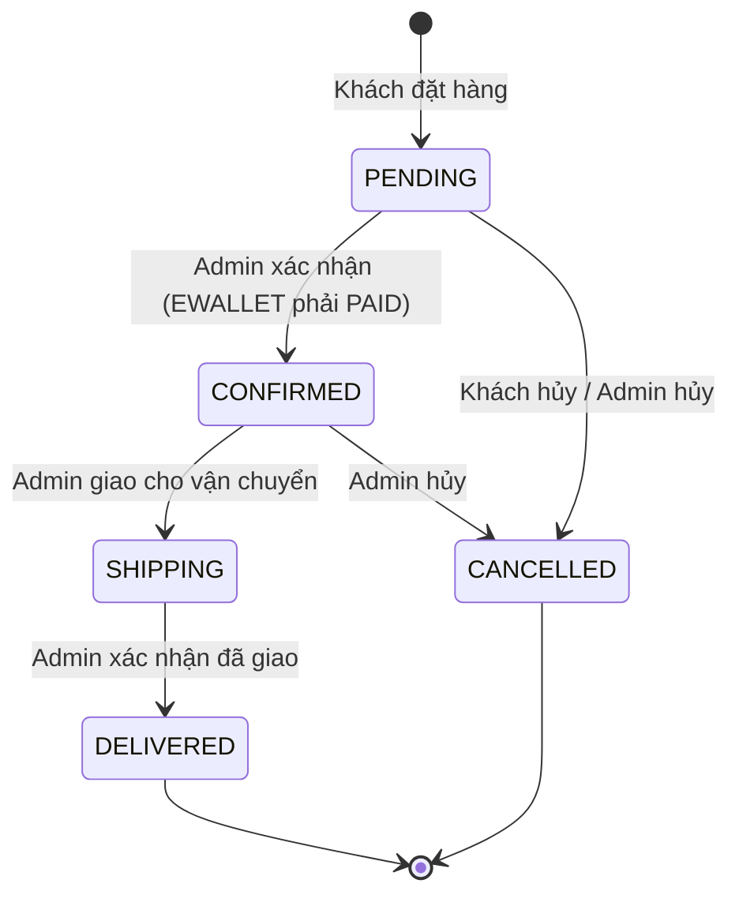

# Healthy Shop – Tài liệu đặc tả hệ thống

**Website thương mại điện tử bán thực phẩm chức năng**

| Mục | Nội dung |
|---|---|
| Hệ thống | Healthy Shop – Website thương mại điện tử bán thực phẩm chức năng (TPCN) |
| Phiên bản tài liệu | 1.0 |
| Người lập | [Họ tên – MSSV] |
| Bạn cặp (Tester) | [Họ tên – MSSV] |
| Ngày lập | 24/10/2026 |
| Link sản phẩm | [http://localhost:3000 – thay bằng link triển khai] |
| Base URL API | [http://localhost:3000/api – thay bằng link triển khai] |

**Nội dung tài liệu**

- [PHẦN A – URD (Tài liệu yêu cầu người dùng)](#phần-a--urd-tài-liệu-yêu-cầu-người-dùng)
- [PHẦN B – SRS (Đặc tả yêu cầu phần mềm)](#phần-b--srs-đặc-tả-yêu-cầu-phần-mềm)
- [PHẦN C – Tài liệu API (Mẫu 01)](#phần-c--tài-liệu-api-mẫu-01)

---

# PHẦN A – URD (Tài liệu yêu cầu người dùng)

## A1. Bối cảnh

Nhu cầu chăm sóc sức khỏe chủ động bằng thực phẩm chức năng (vitamin, khoáng chất, men vi sinh, collagen...) tăng mạnh, nhưng người mua khó kiểm chứng thông tin sản phẩm và dễ gặp quảng cáo sai sự thật. Healthy Shop là cửa hàng trực tuyến giúp người dùng tìm hiểu đầy đủ thông tin sản phẩm (thành phần, công dụng, liều dùng, lưu ý) và đặt mua nhanh chóng; đồng thời giúp chủ cửa hàng quản lý sản phẩm, đơn hàng và doanh thu.

## A2. Mục tiêu

| Mã | Mục tiêu | Chỉ số thành công |
|---|---|---|
| G-01 | Khách tìm được sản phẩm phù hợp nhanh | Tìm thấy sản phẩm trong ≤ 3 thao tác từ trang chủ |
| G-02 | Quy trình mua hàng đơn giản | Hoàn tất đặt hàng từ giỏ hàng trong ≤ 2 phút, ≤ 3 màn hình |
| G-03 | Thông tin sản phẩm minh bạch, đúng quy định | 100% sản phẩm hiển thị thành phần, liều dùng, lưu ý và câu khuyến cáo bắt buộc |
| G-04 | Quản trị viên xử lý đơn hiệu quả | Cập nhật trạng thái 1 đơn trong ≤ 3 thao tác |

## A3. Phạm vi

**Trong phạm vi:** đăng ký/đăng nhập; xem, lọc, sắp xếp, tìm kiếm sản phẩm; xem chi tiết sản phẩm; giỏ hàng; mã giảm giá; đặt hàng; thanh toán khi nhận hàng (COD) và ví điện tử giả lập (OTP); theo dõi và hủy đơn; đánh giá sản phẩm; quản trị sản phẩm, đơn hàng, thống kê.

**Ngoài phạm vi:** cổng thanh toán thật, tích hợp đơn vị vận chuyển thật, gửi email/SMS thật (chỉ ghi nhận nội bộ), tư vấn y khoa trực tuyến, đa ngôn ngữ.

## A4. Vai trò người dùng

| Mã | Vai trò | Mô tả | Nhu cầu chính |
|---|---|---|---|
| R-01 | **Khách vãng lai (Guest)** | Người truy cập chưa đăng nhập | Xem, tìm kiếm sản phẩm, đọc thông tin chi tiết và đánh giá; đăng ký tài khoản |
| R-02 | **Khách hàng (Customer)** | Người đã đăng ký và đăng nhập | Quản lý giỏ hàng, dùng mã giảm giá, đặt hàng, thanh toán, theo dõi/hủy đơn, đánh giá sản phẩm đã mua |
| R-03 | **Quản trị viên (Admin)** | Chủ cửa hàng / nhân viên vận hành | Quản lý sản phẩm, xử lý trạng thái đơn hàng, theo dõi doanh thu và tồn kho |

## A5. User story

Độ ưu tiên theo MoSCoW: **Must** (bắt buộc) · **Should** (nên có) · **Could** (có thể có).

| Mã | Vai trò | User story | Ưu tiên | Tiêu chí nghiệm thu (mức người dùng) |
|---|---|---|---|---|
| US-01 | Khách vãng lai | Là khách vãng lai, tôi muốn xem danh sách sản phẩm theo danh mục và sắp xếp theo giá/bán chạy, để nhanh chóng chọn được sản phẩm phù hợp. | Must | Thấy ảnh, tên, thương hiệu, giá bán, giá gốc (nếu có, bị gạch ngang), đánh giá; lọc được theo 7 danh mục; sắp xếp được 4 kiểu; mỗi trang tối đa 12 sản phẩm. |
| US-02 | Khách vãng lai | Là khách vãng lai, tôi muốn tìm sản phẩm bằng từ khóa (có dấu hoặc không dấu), để tìm đúng sản phẩm mình cần mà không phải duyệt hết danh mục. | Must | Nhập "omega" hoặc "vitamin" ra đúng sản phẩm; kết quả hiển thị trong ≤ 1 giây; từ khóa < 2 ký tự được nhắc nhở. |
| US-03 | Khách vãng lai | Là khách vãng lai, tôi muốn xem chi tiết thành phần, công dụng, liều dùng và lưu ý của sản phẩm, để dùng sản phẩm an toàn và đúng cách. | Must | Có đủ 4 mục thông tin; thông tin liều dùng khớp hàm lượng; luôn có câu "Thực phẩm này không phải là thuốc, không có tác dụng thay thế thuốc chữa bệnh." |
| US-04 | Khách vãng lai | Là khách vãng lai, tôi muốn đăng ký tài khoản bằng email và số điện thoại, để có thể mua hàng và theo dõi đơn. | Must | Đăng ký thành công với dữ liệu hợp lệ; báo rõ trường sai; không cho trùng email. |
| US-05 | Khách hàng | Là khách hàng, tôi muốn đăng nhập và đăng xuất, để bảo vệ tài khoản và đơn hàng của mình. | Must | Đăng nhập đúng → vào được giỏ hàng/đơn hàng; sai 5 lần liên tiếp → tài khoản tạm khóa 15 phút. |
| US-06 | Khách hàng | Là khách hàng, tôi muốn thêm sản phẩm vào giỏ với số lượng mong muốn, để mua nhiều sản phẩm trong một đơn. | Must | Số lượng 1–10/sản phẩm; không vượt tồn kho; sản phẩm hết hàng không thêm được; số trên biểu tượng giỏ cập nhật ngay. |
| US-07 | Khách hàng | Là khách hàng, tôi muốn sửa số lượng hoặc xóa sản phẩm trong giỏ, để điều chỉnh đơn trước khi đặt. | Must | Tổng tiền cập nhật ngay; không chấp nhận số lượng ngoài khoảng 1–10. |
| US-08 | Khách hàng | Là khách hàng, tôi muốn nhập mã giảm giá, để được hưởng ưu đãi. | Should | Mã hợp lệ được trừ tiền đúng quy tắc; mã sai/hết hạn/chưa đủ giá trị tối thiểu bị từ chối kèm lý do rõ ràng. |
| US-09 | Khách hàng | Là khách hàng, tôi muốn đặt hàng với địa chỉ giao hàng và phương thức thanh toán, để nhận sản phẩm tại nhà. | Must | Hiển thị đúng tạm tính, giảm giá, phí ship (miễn phí từ 500.000 ₫), tổng tiền; nhận mã đơn sau khi đặt. |
| US-10 | Khách hàng | Là khách hàng, tôi muốn thanh toán đơn bằng ví điện tử qua mã OTP, để không phải trả tiền mặt khi nhận hàng. | Should | OTP đúng → đơn "Đã thanh toán"; OTP sai → báo lỗi, đơn giữ "Chưa thanh toán". |
| US-11 | Khách hàng | Là khách hàng, tôi muốn xem lịch sử và chi tiết đơn hàng, để theo dõi tình trạng giao hàng. | Must | Thấy danh sách đơn của chính mình; xem chi tiết sản phẩm, tiền, địa chỉ, lịch sử trạng thái. |
| US-12 | Khách hàng | Là khách hàng, tôi muốn hủy đơn khi cửa hàng chưa xác nhận, để thay đổi quyết định mua. | Should | Chỉ hủy được đơn "Chờ xác nhận"; đơn đã xác nhận/đang giao không có nút hủy. |
| US-13 | Khách hàng | Là khách hàng, tôi muốn chấm sao và viết nhận xét cho sản phẩm đã nhận, để chia sẻ trải nghiệm với người mua khác. | Could | Chọn 1–5 sao; nhận xét không bắt buộc (≤ 500 ký tự); chỉ đánh giá sản phẩm thuộc đơn đã giao, mỗi sản phẩm 1 lần. |
| US-14 | Quản trị viên | Là quản trị viên, tôi muốn thêm, sửa, ngừng kinh doanh sản phẩm, để danh mục luôn đúng giá và tồn kho. | Must | Thêm/sửa với dữ liệu hợp lệ; sản phẩm ngừng bán không còn hiện cho khách; chỉ quản trị viên làm được. |
| US-15 | Quản trị viên | Là quản trị viên, tôi muốn xem và cập nhật trạng thái đơn hàng theo đúng quy trình, để khách theo dõi được tiến độ. | Must | Lọc đơn theo trạng thái; chỉ chuyển trạng thái hợp lệ; hủy đơn thì hoàn lại tồn kho. |
| US-16 | Quản trị viên | Là quản trị viên, tôi muốn xem doanh thu, số đơn theo trạng thái, sản phẩm bán chạy và sắp hết hàng, để ra quyết định nhập hàng. | Should | Doanh thu = tổng tiền đơn "Đã giao"; danh sách sản phẩm tồn < 5. |

## A6. Luồng nghiệp vụ (mức người dùng)

**LN-01 – Đăng ký và đăng nhập** (US-04, US-05)
1. Khách vãng lai chọn "Đăng ký", nhập họ tên, email, số điện thoại, mật khẩu.
2. Hệ thống kiểm tra và tạo tài khoản, chuyển sang trang đăng nhập.
3. Người dùng đăng nhập bằng email/mật khẩu; hệ thống chuyển về trang chủ (khách hàng) hoặc trang quản trị (quản trị viên).
4. Người dùng chọn "Đăng xuất" khi kết thúc.

**LN-02 – Mua hàng và thanh toán** (US-01 → US-03, US-06 → US-11)
1. Khách hàng tìm kiếm hoặc duyệt danh mục, mở chi tiết sản phẩm.
2. Chọn số lượng, thêm vào giỏ; điều chỉnh giỏ hàng; nhập mã giảm giá (nếu có).
3. Nhập địa chỉ giao hàng, chọn COD hoặc ví điện tử, xác nhận đặt hàng.
4. Nếu chọn ví điện tử: nhập OTP để thanh toán.
5. Theo dõi đơn trong "Đơn hàng"; có thể hủy khi đơn còn "Chờ xác nhận"; đánh giá sản phẩm khi đã nhận hàng.

**LN-03 – Quản trị sản phẩm và xử lý đơn hàng** (US-14 → US-16)
1. Quản trị viên đăng nhập, vào "Quản trị".
2. Thêm sản phẩm mới / sửa giá, tồn kho / ngừng kinh doanh sản phẩm.
3. Lọc đơn "Chờ xác nhận", xác nhận → giao hàng → đã giao (hoặc hủy).
4. Xem thống kê doanh thu, sản phẩm bán chạy, sản phẩm sắp hết hàng.

---

# PHẦN B – SRS (Đặc tả yêu cầu phần mềm)

## B1. Giới thiệu

### B1.1. Mục đích
Đặc tả đầy đủ, kiểm thử được các yêu cầu chức năng, phi chức năng, ràng buộc dữ liệu và quy tắc nghiệp vụ của Healthy Shop, làm căn cứ để phát triển, viết test case (chức năng/phi chức năng), kiểm thử tự động (Postman/Newman, Puppeteer) và kiểm thử hiệu năng (JMeter).

### B1.2. Thuật ngữ
| Thuật ngữ | Giải thích |
|---|---|
| TPCN | Thực phẩm chức năng (thực phẩm bảo vệ sức khỏe) |
| COD | Cash On Delivery – thanh toán khi nhận hàng |
| EWALLET | Ví điện tử HealthyPay (giả lập, xác thực OTP) |
| JWT | JSON Web Token – mã xác thực gửi trong header `Authorization: Bearer <token>` |
| CCU | Concurrent users – số người dùng đồng thời |
| p95 | Phân vị 95 của thời gian phản hồi |
| Tạm tính (subtotal) | Tổng (đơn giá × số lượng) các dòng trong giỏ |

### B1.3. Tài liệu tham chiếu
- Nghị định 15/2018/NĐ-CP (quy định về an toàn thực phẩm, quảng cáo thực phẩm bảo vệ sức khỏe), Luật Quảng cáo 2012.
- WCAG 2.1 mức AA (độ tương phản, khả năng truy cập).
- Phần A – URD của tài liệu này.

## B2. Mô tả tổng quan

### B2.1. Kiến trúc
```
[Trình duyệt: index.html + style.css + app.js]  --HTTP/JSON-->  [Node.js + Express: server.js]  -->  [Dữ liệu trong bộ nhớ]
```
- Frontend: HTML/CSS/JavaScript thuần, ứng dụng 1 trang (hash routing: `#/`, `#/search?q=`, `#/cart`, `#/checkout`, `#/orders`, `#/orders/{id}`, `#/login`, `#/register`, `#/admin`).
- Backend: REST API JSON, xác thực JWT (HS256), hết hạn 60 phút.
- Dữ liệu: lưu trong bộ nhớ, khởi tạo dữ liệu mẫu (21 sản phẩm có ảnh minh họa, 3 tài khoản, 4 mã giảm giá, 4 đơn hàng, 5 đánh giá) mỗi lần khởi động.

### B2.2. Môi trường
| Thành phần | Yêu cầu |
|---|---|
| Máy chủ | Node.js ≥ 18, RAM ≥ 512 MB, cổng mặc định 3000 (biến môi trường `PORT`) |
| Trình duyệt | Chrome, Edge, Firefox (2 phiên bản mới nhất) |
| Độ phân giải | 360 px – 1920 px chiều ngang |

### B2.3. Giả định và ràng buộc
- Dữ liệu được đặt lại về dữ liệu mẫu khi máy chủ khởi động lại (phục vụ kiểm thử lặp lại).
- Múi giờ hệ thống: Asia/Ho_Chi_Minh (UTC+07:00); thời gian trả về theo ISO 8601.
- Tiền tệ: VNĐ, số nguyên, không có phần thập phân.
- Ví điện tử là giả lập: mã OTP thử nghiệm cố định `123456`.

## B3. Ma trận phân quyền

✔ = được phép · ✘ = bị từ chối (401 nếu chưa đăng nhập, 403 nếu sai vai trò)

| Chức năng | Khách vãng lai | Khách hàng | Quản trị viên |
|---|:-:|:-:|:-:|
| FR-01 Đăng ký | ✔ | – | – |
| FR-02 Đăng nhập | ✔ | ✔ | ✔ |
| FR-03 Xem hồ sơ, đăng xuất | ✘ (401) | ✔ | ✔ |
| FR-04 Xem danh sách sản phẩm, danh mục | ✔ | ✔ | ✔ |
| FR-05 Tìm kiếm sản phẩm | ✔ | ✔ | ✔ |
| FR-06 Xem chi tiết sản phẩm | ✔ | ✔ | ✔ |
| FR-07 Quản lý giỏ hàng | ✘ (401) | ✔ | ✘ (403) |
| FR-08 Áp dụng mã giảm giá | ✘ (401) | ✔ | ✘ (403) |
| FR-09 Đặt hàng | ✘ (401) | ✔ | ✘ (403) |
| FR-10 Thanh toán ví điện tử | ✘ (401) | ✔ (đơn của mình) | ✘ (403) |
| FR-11 Xem lịch sử / chi tiết đơn | ✘ (401) | ✔ (đơn của mình) | ✘ (403) – dùng FR-15 |
| FR-12 Hủy đơn hàng | ✘ (401) | ✔ (đơn của mình) | ✘ (403) – dùng FR-15 |
| FR-13 Xem đánh giá | ✔ | ✔ | ✔ |
| FR-13 Viết đánh giá | ✘ (401) | ✔ | ✘ (403) |
| FR-14 Quản lý sản phẩm (xem/thêm/sửa/ngừng bán) | ✘ (401) | ✘ (403) | ✔ |
| FR-15 Quản lý đơn hàng | ✘ (401) | ✘ (403) | ✔ |
| FR-16 Thống kê | ✘ (401) | ✘ (403) | ✔ |

## B4. Yêu cầu chức năng (FR)

### FR-01 – Đăng ký tài khoản
- **Vai trò:** Khách vãng lai · **Truy vết:** US-04 · **API:** `POST /api/auth/register`
- **Đầu vào & ràng buộc:** `fullName` 2–50 ký tự; `email` đúng định dạng, ≤ 100 ký tự, chưa tồn tại (không phân biệt hoa thường); `phone` 10 chữ số, bắt đầu bằng 0; `password` 8–32 ký tự, có ít nhất 1 chữ cái và 1 chữ số. Giao diện yêu cầu nhập lại mật khẩu khớp.
- **Xử lý:** tạo tài khoản vai trò CUSTOMER, mật khẩu băm SHA-256 + salt ngẫu nhiên; email lưu chữ thường.
- **Kết quả:** 201 + thông tin tài khoản (không chứa mật khẩu). Sai dữ liệu → 400 kèm lỗi từng trường; trùng email → 409.

### FR-02 – Đăng nhập
- **Vai trò:** Tất cả · **Truy vết:** US-05 · **API:** `POST /api/auth/login`
- **Đầu vào:** `email`, `password` (bắt buộc).
- **Xử lý:** đúng → cấp JWT hết hạn sau 60 phút, đặt lại bộ đếm sai. Sai → 401 "Email hoặc mật khẩu không đúng" (không tiết lộ email có tồn tại hay không). Sai **5 lần liên tiếp** → khóa **15 phút** (423), kể cả khi nhập đúng trong thời gian khóa.
- **Kết quả giao diện:** khách hàng → trang chủ; quản trị viên → trang quản trị.

### FR-03 – Xem hồ sơ và đăng xuất
- **Vai trò:** Khách hàng, Quản trị viên · **Truy vết:** US-05 · **API:** `GET /api/auth/me`, `POST /api/auth/logout`
- **Xử lý:** `me` trả thông tin tài khoản từ token. `logout` thu hồi token hiện tại; mọi request sau đó dùng token này nhận 401.

### FR-04 – Xem danh sách sản phẩm
- **Vai trò:** Tất cả · **Truy vết:** US-01 · **API:** `GET /api/products`, `GET /api/categories`
- **Tham số:** `category` (1 trong 7 mã danh mục), `sort` ∈ {`newest` (mặc định), `price_asc`, `price_desc`, `best_selling`}, `minPrice`/`maxPrice` (≥ 0, max ≥ min), `page` ≥ 1 (mặc định 1), `size` 1–50 (mặc định 12).
- **Xử lý:** chỉ trả sản phẩm đang kinh doanh. Tham số sai → 400.
- **Hiển thị:** mỗi thẻ có ảnh sản phẩm (ảnh lỗi → ảnh thay thế mặc định), thương hiệu, tên, số sao + số đánh giá + đã bán, **giá bán nổi bật màu đỏ**, **giá gốc (nếu có) màu xám, gạch ngang**, nhãn "-x%" hoặc "Hết hàng", quy cách; nút "Thêm vào giỏ" bị vô hiệu khi hết hàng.

### FR-05 – Tìm kiếm sản phẩm
- **Vai trò:** Tất cả · **Truy vết:** US-02 · **API:** `GET /api/products/search?q=`
- **Ràng buộc:** `q` 2–100 ký tự sau khi bỏ khoảng trắng đầu/cuối.
- **Xử lý:** tìm không phân biệt hoa thường và dấu tiếng Việt trong tên, thương hiệu, mô tả ngắn, thành phần, công dụng; sắp xếp theo bán chạy; có phân trang. Không có kết quả → 200 với mảng rỗng.
- **Hiệu năng:** xem NFR-02.

### FR-06 – Xem chi tiết sản phẩm
- **Vai trò:** Tất cả · **Truy vết:** US-03 · **API:** `GET /api/products/{id}`
- **Xử lý:** trả đầy đủ thông tin + tên danh mục + câu khuyến cáo (`disclaimer`) + tối đa 4 sản phẩm liên quan. Sản phẩm không tồn tại/ngừng bán → 404.
- **Hiển thị:** thành phần, công dụng, liều dùng & cách dùng, lưu ý, khung khuyến cáo; tình trạng kho: "Còn hàng (n)" khi ≥ 5, "Chỉ còn n sản phẩm" khi 1–4, "Hết hàng" khi 0; ô số lượng 1–10.
- **Nội dung:** tuân thủ NFR-12.

### FR-07 – Quản lý giỏ hàng
- **Vai trò:** Khách hàng · **Truy vết:** US-06, US-07 · **API:** `GET /api/cart`, `POST /api/cart/items`, `PUT /api/cart/items/{productId}`, `DELETE /api/cart/items/{productId}`
- **Ràng buộc (BR-03):** số lượng mỗi sản phẩm là số nguyên **1–10**; tổng số lượng của một sản phẩm trong giỏ ≤ 10 và ≤ tồn kho; sản phẩm phải đang kinh doanh và còn hàng.
- **Xử lý:** thêm sản phẩm đã có trong giỏ → cộng dồn số lượng. Mọi thao tác trả về giỏ hàng đã tính lại (tạm tính, giảm giá, phí ship, tổng). Vượt tồn kho → 409 với thông báo "Sản phẩm "{tên}" chỉ còn {n} sản phẩm trong kho". Hết hàng → 409 "Sản phẩm "{tên}" đã hết hàng".
- **Giỏ hàng lưu phía máy chủ theo tài khoản.**

### FR-08 – Áp dụng mã giảm giá
- **Vai trò:** Khách hàng · **Truy vết:** US-08 · **API:** `POST /api/cart/coupon`, `DELETE /api/cart/coupon`
- **Ràng buộc:** `code` 4–20 ký tự chữ/số, không phân biệt hoa thường; giỏ hàng không rỗng; mỗi giỏ 1 mã.
- **Xử lý:** theo BR-02 và bảng quyết định B6.1.

### FR-09 – Đặt hàng
- **Vai trò:** Khách hàng · **Truy vết:** US-09 · **API:** `POST /api/orders`
- **Đầu vào:** `shippingAddress.fullName` 2–50 ký tự; `shippingAddress.phone` 10 chữ số bắt đầu bằng 0; `shippingAddress.address` 10–200 ký tự; `paymentMethod` ∈ {COD, EWALLET}; `note` **không bắt buộc**, chuỗi ≤ 200 ký tự.
- **Xử lý:** kiểm tra giỏ không rỗng, từng sản phẩm còn kinh doanh và đủ tồn kho, mã giảm giá còn hợp lệ; tính tiền theo BR-01, BR-02; tạo đơn mã `ORD-YYYYMMDD-NNNN`, trạng thái PENDING, thanh toán UNPAID; trừ tồn kho, tăng số đã bán; làm rỗng giỏ; ghi nhận tin nhắn xác nhận nội bộ.
- **Kết quả:** 201 + chi tiết đơn.

### FR-10 – Thanh toán ví điện tử (giả lập OTP)
- **Vai trò:** Khách hàng · **Truy vết:** US-10 · **API:** `POST /api/orders/{id}/pay`
- **Điều kiện:** đơn của chính khách hàng, `paymentMethod = EWALLET`, `paymentStatus = UNPAID`, `status = PENDING`.
- **Xử lý:** `otp` 6 chữ số; đúng `123456` → PAID, ghi `paidAt`; sai → 400 PAYMENT_FAILED. Xem bảng quyết định B6.2.

### FR-11 – Xem lịch sử và chi tiết đơn hàng
- **Vai trò:** Khách hàng · **Truy vết:** US-11 · **API:** `GET /api/orders`, `GET /api/orders/{id}`
- **Xử lý:** chỉ trả đơn của chính người dùng, mới nhất trước, phân trang (mặc định 10). Đơn của người khác hoặc không tồn tại → 404. Chi tiết gồm sản phẩm, tiền, địa chỉ, ghi chú, lịch sử trạng thái, cờ `canCancel`, `canPay`.

### FR-12 – Hủy đơn hàng
- **Vai trò:** Khách hàng · **Truy vết:** US-12 · **API:** `POST /api/orders/{id}/cancel`
- **Ràng buộc (BR-04):** khách hàng **chỉ hủy được đơn ở trạng thái PENDING**; `reason` không bắt buộc, ≤ 200 ký tự.
- **Xử lý:** chuyển CANCELLED, hoàn tồn kho (BR-05); nếu đã thanh toán → REFUNDED. Trạng thái khác → 409. Giao diện chỉ hiển thị nút "Hủy đơn hàng" khi `canCancel = true`.

### FR-13 – Đánh giá sản phẩm
- **Vai trò:** xem: tất cả; viết: Khách hàng · **Truy vết:** US-13 · **API:** `GET /api/products/{id}/reviews`, `POST /api/products/{id}/reviews`
- **Ràng buộc:** `rating` số nguyên 1–5 (bắt buộc); `comment` **không bắt buộc**, ≤ 500 ký tự; chỉ đánh giá sản phẩm có trong đơn DELIVERED của mình (403 nếu chưa mua); mỗi khách 1 đánh giá/sản phẩm (409).
- **Xử lý:** điểm trung bình làm tròn 1 chữ số thập phân, cập nhật ngay trên thẻ và trang chi tiết.

### FR-14 – Quản lý sản phẩm (Quản trị)
- **Vai trò:** Quản trị viên · **Truy vết:** US-14 · **API:** `GET/POST /api/admin/products`, `PUT/DELETE /api/admin/products/{id}`
- **Ràng buộc dữ liệu:** xem B5. Tên không trùng (409).
- **Xử lý:** xem tất cả sản phẩm (kể cả ngừng bán); thêm (201); sửa từng phần (chỉ trường gửi lên); "xóa" = ngừng kinh doanh (`isActive = false`), sản phẩm ngừng bán không hiển thị với khách và không đặt được. **Chỉ vai trò ADMIN** – các vai trò khác nhận 403 với mọi API `/api/admin/*`.

### FR-15 – Quản lý đơn hàng (Quản trị)
- **Vai trò:** Quản trị viên · **Truy vết:** US-15 · **API:** `GET /api/admin/orders`, `PATCH /api/admin/orders/{id}/status`
- **Xử lý:** lọc theo trạng thái, phân trang (mặc định 20); chuyển trạng thái theo sơ đồ B7; đơn EWALLET chưa thanh toán không được xác nhận (409); hủy → hoàn kho, hoàn tiền nếu đã thanh toán; DELIVERED với COD → PAID. Trả `nextStatuses` để giao diện chỉ hiện các bước hợp lệ.

### FR-16 – Thống kê (Quản trị)
- **Vai trò:** Quản trị viên · **Truy vết:** US-16 · **API:** `GET /api/admin/stats`
- **Xử lý:** doanh thu = tổng `total` các đơn DELIVERED; tổng số đơn; số đơn theo 5 trạng thái; số khách hàng; số sản phẩm đang bán; danh sách sản phẩm tồn < 5; top 5 sản phẩm theo số lượng bán (không tính đơn đã hủy).

## B5. Quy tắc nghiệp vụ (BR) và ràng buộc dữ liệu

### B5.1. Quy tắc nghiệp vụ
| Mã | Quy tắc |
|---|---|
| BR-01 | **Phí vận chuyển:** 30.000 ₫/đơn. **Miễn phí khi tạm tính ≥ 500.000 ₫** (đúng 500.000 ₫ được miễn phí) hoặc khi dùng mã FREESHIP. Giỏ rỗng: phí 0. |
| BR-02 | **Mã giảm giá:** mã phải tồn tại, **còn hạn** (thời điểm hiện tại ≤ `expiresAt`), tạm tính ≥ giá trị đơn tối thiểu. PERCENT: giảm `value`% tạm tính, làm tròn xuống, tối đa `maxDiscount`. FIXED: giảm `value`, không vượt tạm tính. FREESHIP: phí ship = 0. Tổng tiền = tạm tính − giảm giá + phí ship (luôn ≥ 0). |
| BR-03 | **Số lượng:** mỗi sản phẩm trong giỏ/đơn là số nguyên từ 1 đến 10 và không vượt tồn kho. |
| BR-04 | **Hủy đơn:** khách hàng chỉ hủy được đơn PENDING; quản trị viên hủy được đơn PENDING hoặc CONFIRMED. Đơn SHIPPING, DELIVERED, CANCELLED không thể hủy. |
| BR-05 | **Tồn kho:** trừ khi đặt hàng thành công; cộng lại khi đơn bị hủy. Tồn kho không bao giờ âm và không tăng khi đặt hàng. |
| BR-06 | **Thanh toán:** COD → PAID khi đơn DELIVERED. EWALLET phải PAID trước khi được chuyển CONFIRMED. Đơn đã PAID bị hủy → REFUNDED. |
| BR-07 | **Tài khoản:** email duy nhất; sai mật khẩu 5 lần liên tiếp khóa 15 phút; token hết hạn sau 60 phút hoặc khi đăng xuất. |

### B5.2. Mã giảm giá có sẵn (dữ liệu mẫu)
| Mã | Loại | Giá trị | Giảm tối đa | Đơn tối thiểu | Hạn dùng |
|---|---|---|---|---|---|
| VITA10 | PERCENT | 10% | 50.000 ₫ | 200.000 ₫ | 31/12/2027 |
| NEWUSER50 | FIXED | 50.000 ₫ | 50.000 ₫ | 300.000 ₫ | 31/12/2027 |
| FREESHIP | FREESHIP | Miễn phí ship | – | 0 ₫ | 31/12/2027 |
| SUMMER20 | PERCENT | 20% | 100.000 ₫ | 0 ₫ | 31/08/2026 (**đã hết hạn**) |

### B5.3. Từ điển dữ liệu
| Thực thể.Trường | Kiểu | Bắt buộc | Ràng buộc |
|---|---|---|---|
| User.fullName | string | Có | 2–50 ký tự |
| User.email | string | Có | Định dạng email, ≤ 100 ký tự, duy nhất |
| User.phone | string | Có | `^0\d{9}$` |
| User.password | string | Có | 8–32 ký tự, ≥ 1 chữ cái, ≥ 1 chữ số |
| User.role | enum | Có | CUSTOMER, ADMIN |
| Product.id | string | Tự sinh | `P` + 3 chữ số (P001…) |
| Product.name | string | Có | 3–150 ký tự, duy nhất |
| Product.category | enum | Có | vitamin, xuong-khop, tieu-hoa, lam-dep, tim-mach, than-kinh, me-be |
| Product.brand | string | Có | 1–50 ký tự |
| Product.price | integer | Có | 1.000 – 50.000.000 (₫) |
| Product.originalPrice | integer/null | Không | null hoặc 1.000 – 50.000.000 và **> price** |
| Product.stock | integer | Có | 0 – 9.999 |
| Product.unit | string | Có | 1–50 ký tự (vd "Hộp 60 viên") |
| Product.origin | string | Không | 1–50 ký tự (mặc định "Việt Nam") |
| Product.image | string | Không | Đường dẫn ảnh `http(s)://...` hoặc `/images/...`, ≤ 500 ký tự (mặc định `/images/placeholder.svg`) |
| Product.shortDescription | string | Không | ≤ 200 ký tự |
| Product.ingredients / uses | string | Không | ≤ 1.000 ký tự |
| Product.dosage / warning | string | Không | ≤ 500 ký tự |
| CartItem.quantity | integer | Có | 1 – 10, ≤ tồn kho |
| Coupon.code | string | Có | 4–20 ký tự `[A-Za-z0-9]`, lưu chữ in hoa |
| Order.id | string | Tự sinh | `ORD-YYYYMMDD-NNNN` |
| Order.status | enum | Có | PENDING, CONFIRMED, SHIPPING, DELIVERED, CANCELLED |
| Order.paymentMethod | enum | Có | COD, EWALLET |
| Order.paymentStatus | enum | Có | UNPAID, PAID, REFUNDED |
| Order.shippingAddress.address | string | Có | 10–200 ký tự |
| Order.note | string | Không | ≤ 200 ký tự (mặc định rỗng) |
| Order.cancelReason | string | Không | ≤ 200 ký tự |
| Review.rating | integer | Có | 1 – 5 |
| Review.comment | string | Không | ≤ 500 ký tự |
| Payment.otp | string | Có | 6 chữ số |
| Query.page / size | integer | Không | page ≥ 1; size 1–50 |

## B6. Bảng quyết định

### B6.1. Áp dụng mã giảm giá (FR-08, BR-02)
| Điều kiện / Hành động | R1 | R2 | R3 | R4 | R5 | R6 |
|---|:-:|:-:|:-:|:-:|:-:|:-:|
| C1. `code` đúng định dạng (4–20 chữ/số) | N | Y | Y | Y | Y | Y |
| C2. Giỏ hàng có sản phẩm | – | N | Y | Y | Y | Y |
| C3. Mã tồn tại | – | – | N | Y | Y | Y |
| C4. Mã còn hạn | – | – | – | N | Y | Y |
| C5. Tạm tính ≥ đơn tối thiểu | – | – | – | – | N | Y |
| **Kết quả** | 400 VALIDATION_ERROR | 400 "Giỏ hàng trống" | 404 "Mã giảm giá không tồn tại" | 400 "Mã giảm giá đã hết hạn" | 400 "Đơn hàng tối thiểu ..." | 200, áp dụng mã |

Ví dụ tính (R6): giỏ 450.000 ₫ + VITA10 → giảm 45.000 ₫, ship 30.000 ₫, tổng 435.000 ₫. Giỏ 600.000 ₫ + VITA10 → giảm 50.000 ₫ (chạm trần), ship 0 ₫, tổng 550.000 ₫.

### B6.2. Thanh toán ví điện tử (FR-10, BR-06)
| Điều kiện / Hành động | R1 | R2 | R3 | R4 | R5 | R6 |
|---|:-:|:-:|:-:|:-:|:-:|:-:|
| C1. OTP gồm 6 chữ số | N | Y | Y | Y | Y | Y |
| C2. Phương thức = EWALLET | – | N | Y | Y | Y | Y |
| C3. Chưa thanh toán (UNPAID) | – | – | N | Y | Y | Y |
| C4. Trạng thái đơn = PENDING | – | – | – | N | Y | Y |
| C5. OTP = 123456 | – | – | – | – | N | Y |
| **Kết quả** | 400 VALIDATION_ERROR | 409 "Đơn COD..." | 409 "Đã thanh toán" | 409 "Chỉ thanh toán đơn chờ xác nhận" | 400 PAYMENT_FAILED | 200, PAID |

### B6.3. Tính phí vận chuyển (BR-01)
| Điều kiện | R1 | R2 | R3 | R4 |
|---|:-:|:-:|:-:|:-:|
| Giỏ rỗng | Y | N | N | N |
| Có mã FREESHIP hợp lệ | – | Y | N | N |
| Tạm tính ≥ 500.000 ₫ | – | – | Y | N |
| **Phí ship** | 0 ₫ | 0 ₫ | 0 ₫ | 30.000 ₫ |

Giá trị biên kiểm thử: 499.000 ₫ → 30.000 ₫; **500.000 ₫ → 0 ₫**; 500.001 ₫ → 0 ₫.

## B7. Sơ đồ trạng thái đơn hàng (FR-12, FR-15, BR-04)



| Trạng thái hiện tại | Chuyển hợp lệ | Ai thực hiện | Chuyển không hợp lệ (→ 409) |
|---|---|---|---|
| PENDING (Chờ xác nhận) | CONFIRMED, CANCELLED | Admin; Khách (chỉ CANCELLED) | SHIPPING, DELIVERED |
| CONFIRMED (Đã xác nhận) | SHIPPING, CANCELLED | Admin | PENDING, DELIVERED; khách hủy |
| SHIPPING (Đang giao) | DELIVERED | Admin | Mọi trạng thái khác; khách hủy |
| DELIVERED (Đã giao) | – | – | Tất cả |
| CANCELLED (Đã hủy) | – | – | Tất cả |

Trạng thái thanh toán: `UNPAID → PAID` (OTP đúng hoặc COD giao thành công); `PAID → REFUNDED` (đơn bị hủy).

## B8. Luồng nghiệp vụ hoàn chỉnh (Use case)

### UC-01 – Đăng ký và đăng nhập (FR-01, FR-02, FR-03)
| Mục | Nội dung |
|---|---|
| Tác nhân | Khách vãng lai, Khách hàng, Quản trị viên |
| Tiền điều kiện | Chưa đăng nhập |
| Hậu điều kiện | Người dùng có token hợp lệ 60 phút; giao diện hiển thị theo vai trò |

**Luồng chính**
1. Khách chọn "Đăng ký" (`#/register`), nhập họ tên, email, SĐT, mật khẩu, nhập lại mật khẩu.
2. Hệ thống kiểm tra (FR-01), tạo tài khoản CUSTOMER, thông báo "Đăng ký thành công! Vui lòng đăng nhập." và chuyển tới `#/login`.
3. Người dùng nhập email, mật khẩu, bấm "Đăng nhập".
4. Hệ thống xác thực, trả token; giao diện lưu phiên, hiện tên người dùng, menu theo vai trò; chuyển tới trang chủ (khách hàng) hoặc `#/admin` (quản trị viên).
5. Người dùng bấm "Đăng xuất" → token bị thu hồi, quay về trang chủ.

**Luồng thay thế**
- 1a. Đã có tài khoản → đi thẳng bước 3.
- 4a. Tài khoản quản trị → vào trang quản trị, không thấy menu Giỏ hàng/Đơn hàng.

**Luồng ngoại lệ**
- 2a. Dữ liệu sai → 400, hiển thị lỗi dưới từng ô; mật khẩu nhập lại không khớp → báo ngay trên giao diện, không gửi API.
- 2b. Email đã tồn tại → 409 "Email đã được sử dụng, vui lòng dùng email khác".
- 4b. Sai email/mật khẩu → 401 "Email hoặc mật khẩu không đúng".
- 4c. Sai 5 lần liên tiếp → 423 "Tài khoản tạm khóa ... 15 phút".
- 4d. Token hết hạn khi đang dùng → 401, giao diện xóa phiên, chuyển về đăng nhập.

### UC-02 – Mua hàng và thanh toán (FR-04 → FR-12)
| Mục | Nội dung |
|---|---|
| Tác nhân | Khách hàng (Khách vãng lai ở bước duyệt/tìm kiếm) |
| Tiền điều kiện | Đã đăng nhập vai trò CUSTOMER (từ bước thêm vào giỏ) |
| Hậu điều kiện | Đơn hàng PENDING được tạo; tồn kho giảm; giỏ hàng rỗng; (EWALLET) đơn PAID |

**Luồng chính**
1. Khách tìm kiếm (FR-05) hoặc chọn danh mục/sắp xếp (FR-04).
2. Mở chi tiết sản phẩm (FR-06), chọn số lượng 1–10, bấm "Thêm vào giỏ hàng" (FR-07).
3. Vào "Giỏ hàng", sửa số lượng/xóa dòng; hệ thống tính lại tạm tính, phí ship, tổng.
4. Nhập mã giảm giá (FR-08), bấm "Áp dụng".
5. Bấm "Tiến hành đặt hàng", nhập họ tên, SĐT, địa chỉ, ghi chú (tùy chọn), chọn COD.
6. Bấm "Đặt hàng" → hệ thống tạo đơn (FR-09), chuyển tới trang chi tiết đơn, báo "Đặt hàng thành công! Mã đơn: ...".
7. Khách theo dõi đơn tại "Đơn hàng" (FR-11).

**Luồng thay thế**
- 1a. Không có kết quả tìm kiếm → hiển thị "Không tìm thấy sản phẩm phù hợp".
- 2a. Khách vãng lai bấm "Thêm vào giỏ" → nhắc đăng nhập, chuyển `#/login` (UC-01), sau đó tiếp tục bước 2.
- 4a. Không dùng mã → bỏ qua bước 4.
- 5a. Chọn EWALLET → sau bước 6, trang chi tiết đơn hiển thị ô OTP; khách nhập 123456, bấm "Xác nhận thanh toán" (FR-10) → "Đã thanh toán".
- 7a. Đơn còn PENDING → khách bấm "Hủy đơn hàng", xác nhận → CANCELLED, hoàn kho (FR-12).
- 7b. Đơn đã DELIVERED → khách đánh giá sản phẩm (FR-13).

**Luồng ngoại lệ**
- 2b. Sản phẩm hết hàng → nút bị vô hiệu; gọi API → 409 "đã hết hàng".
- 2c. Vượt tồn kho/vượt 10 → 409/400 kèm thông báo số lượng còn lại.
- 4b. Mã sai/hết hạn/chưa đủ đơn tối thiểu → thông báo theo bảng B6.1, giỏ không đổi.
- 6a. Thiếu/sai thông tin giao hàng → 400, báo lỗi dưới từng ô.
- 6b. Trong lúc đặt, tồn kho không đủ → 409, khách quay lại giỏ điều chỉnh.
- 6c. Giỏ rỗng → 400 "Giỏ hàng trống...".
- 5a-1. OTP sai → 400 "Mã OTP không đúng, vui lòng kiểm tra lại", đơn giữ UNPAID.
- 7a-1. Đơn không còn PENDING → không có nút hủy; gọi API → 409.

### UC-03 – Quản trị sản phẩm và xử lý đơn hàng (FR-14, FR-15, FR-16)
| Mục | Nội dung |
|---|---|
| Tác nhân | Quản trị viên |
| Tiền điều kiện | Đăng nhập vai trò ADMIN |
| Hậu điều kiện | Dữ liệu sản phẩm/đơn hàng được cập nhật; khách thấy thay đổi ngay |

**Luồng chính**
1. Quản trị viên vào `#/admin`, tab "Sản phẩm" hiển thị toàn bộ sản phẩm.
2. Bấm "+ Thêm sản phẩm", nhập thông tin, bấm "Thêm sản phẩm" → 201, sản phẩm xuất hiện ở trang chủ.
3. Bấm "Sửa" một sản phẩm, đổi giá/tồn kho, bấm "Lưu thay đổi".
4. Chuyển tab "Đơn hàng", lọc "Chờ xác nhận", chọn trạng thái tiếp theo "Đã xác nhận" → "Đang giao" → "Đã giao".
5. Chuyển tab "Thống kê" xem doanh thu, đơn theo trạng thái, top bán chạy, sắp hết hàng.

**Luồng thay thế**
- 3a. Bấm "Ngừng bán", xác nhận → sản phẩm ẩn với khách, dòng chuyển màu xám.
- 4a. Chọn "Đã hủy" cho đơn PENDING/CONFIRMED → hoàn kho; nếu đã thanh toán → REFUNDED.

**Luồng ngoại lệ**
- 2a/3b. Dữ liệu sai (giá < 1.000, giá gốc ≤ giá bán, tồn kho âm...) → 400, báo lỗi từng ô; trùng tên → 409.
- 4b. Chuyển trạng thái sai quy trình → 409 "Không thể chuyển đơn hàng từ X sang Y".
- 4c. Xác nhận đơn EWALLET chưa thanh toán → 409.
- 1a. Tài khoản không phải ADMIN truy cập `#/admin` hoặc gọi `/api/admin/*` → giao diện báo không có quyền; API trả 403.

## B9. Yêu cầu phi chức năng (NFR)

Điều kiện đo chuẩn cho NFR hiệu năng: máy chủ chạy 1 tiến trình Node.js, dữ liệu mẫu ban đầu, đo bằng JMeter từ máy trong cùng mạng LAN, ramp-up 30 giây, thời gian giữ tải 3 phút (trừ khi ghi khác).

| Mã | Loại | Yêu cầu | Chỉ số đo được | Cách đo |
|---|---|---|---|---|
| NFR-01 | **Hiệu năng** – Danh sách sản phẩm | `GET /api/products` phản hồi nhanh khi tải cao | **p95 ≤ 500 ms**, tỉ lệ lỗi ≤ 1% ở **100 CCU** | JMeter Thread Group 100 threads, Aggregate Report |
| NFR-02 | **Hiệu năng** – Tìm kiếm | `GET /api/products/search` | **p95 ≤ 1.000 ms** ở **50 CCU**; 1 người dùng: ≤ 1.000 ms | JMeter 50 threads; Postman (Response time) |
| NFR-03 | **Hiệu năng** – Chi tiết sản phẩm | `GET /api/products/{id}` | **Throughput ≥ 50 req/s** và **p95 ≤ 800 ms** ở **50 CCU** | JMeter Summary Report (Throughput) |
| NFR-04 | **Hiệu năng** – Đặt hàng | Luồng thêm giỏ + `POST /api/orders` | **p95 ≤ 1.500 ms**, lỗi ≤ 1% ở **30 CCU** (30 tài khoản khác nhau) | JMeter + CSV Data Set (tài khoản đăng ký sẵn) |
| NFR-05 | **Hiệu năng** – Đăng nhập | `POST /api/auth/login` | **p95 ≤ 800 ms** ở **50 CCU** | JMeter 50 threads |
| NFR-06 | **Hiệu năng** – Tải trang | Trang chủ | DOMContentLoaded **≤ 3 s** (mạng 10 Mbps); tổng tài nguyên trang chủ **≤ 1,5 MB** kể cả 12 ảnh sản phẩm; **≤ 25** request | Chrome DevTools / Lighthouse |
| NFR-07 | Độ tin cậy | Hệ thống không dừng khi nhận dữ liệu sai hoặc thiếu trường tùy chọn | **100%** request sai định dạng/thiếu trường trả **4xx trong ≤ 1 s** và máy chủ vẫn phản hồi `GET /api/health`; uptime **≥ 99%** trong tuần 6–14 | Postman/Newman (negative test), kiểm tra health sau mỗi request |
| NFR-08 | Bảo mật – Phân quyền | Kiểm soát truy cập theo ma trận B3 | **100%** API `/api/admin/*` trả **403** với CUSTOMER, **401** khi thiếu/sai token; token hết hạn sau **60 phút** | Postman: gọi từng API admin với token khách hàng |
| NFR-09 | Bảo mật – Tài khoản | Bảo vệ mật khẩu, chống dò mật khẩu | Mật khẩu lưu dạng băm SHA-256 + salt 16 byte, không trả về trong API; khóa **15 phút** sau **5** lần sai liên tiếp | Postman: đăng nhập sai 6 lần |
| NFR-10 | Khả dụng – Giao diện | Responsive và dễ đọc | Hiển thị đúng ở **360 – 1920 px**, **không có thanh cuộn ngang**; độ tương phản chữ/nền **≥ 4,5:1** (WCAG AA) cho mọi nút và chữ nội dung | Puppeteer đặt viewport 375/768/1366 px, đo `scrollWidth ≤ innerWidth`; công cụ đo tương phản |
| NFR-11 | Khả dụng – Thông báo lỗi | Thông báo lỗi dễ hiểu | **100%** thông báo lỗi bằng tiếng Việt, nêu rõ nguyên nhân/cách khắc phục, **≤ 150 ký tự**, không chứa mã kỹ thuật, `undefined`, `null`, `[object Object]` | Kiểm tra trường `message` mọi response 4xx |
| NFR-12 | Tuân thủ nội dung (pháp lý, y tế) | Thông tin TPCN chính xác, đúng quy định quảng cáo | **100%** trang chi tiết hiển thị câu "Thực phẩm này không phải là thuốc, không có tác dụng thay thế thuốc chữa bệnh."; **0** sản phẩm có nội dung quảng cáo như thuốc ("điều trị", "đặc trị", "chữa khỏi", "thay thế thuốc"); **100%** liều dùng ghi đúng đơn vị hàm lượng như phần thành phần | Rà soát 21/21 sản phẩm |
| NFR-13 | Tương thích | Trình duyệt | Hoạt động đầy đủ trên Chrome, Edge, Firefox 2 phiên bản mới nhất; không lỗi JavaScript trên Console | Kiểm thử thủ công + Puppeteer (bắt `pageerror`) |

## B10. Ma trận truy vết

| User story | Chức năng (SRS) | Quy tắc / NFR liên quan | API |
|---|---|---|---|
| US-01 | FR-04 | NFR-01, NFR-06, NFR-10 | GET /api/products, GET /api/categories |
| US-02 | FR-05 | NFR-02 | GET /api/products/search |
| US-03 | FR-06 | NFR-03, NFR-12 | GET /api/products/{id} |
| US-04 | FR-01 | NFR-09, NFR-11 | POST /api/auth/register |
| US-05 | FR-02, FR-03 | BR-07, NFR-05, NFR-08, NFR-09 | POST /api/auth/login, GET /api/auth/me, POST /api/auth/logout |
| US-06 | FR-07 | BR-03, NFR-11 | POST /api/cart/items, GET /api/cart |
| US-07 | FR-07 | BR-03 | PUT, DELETE /api/cart/items/{productId} |
| US-08 | FR-08 | BR-02, B6.1 | POST, DELETE /api/cart/coupon |
| US-09 | FR-09 | BR-01, BR-02, BR-05, NFR-04, NFR-07 | POST /api/orders |
| US-10 | FR-10 | BR-06, B6.2 | POST /api/orders/{id}/pay |
| US-11 | FR-11 | NFR-08 | GET /api/orders, GET /api/orders/{id} |
| US-12 | FR-12 | BR-04, BR-05, B7 | POST /api/orders/{id}/cancel |
| US-13 | FR-13 | NFR-07 | GET, POST /api/products/{id}/reviews |
| US-14 | FR-14 | NFR-08 | GET, POST /api/admin/products; PUT, DELETE /api/admin/products/{id} |
| US-15 | FR-15 | BR-04, BR-05, BR-06, B7 | GET /api/admin/orders, PATCH /api/admin/orders/{id}/status |
| US-16 | FR-16 | – | GET /api/admin/stats |

---

# PHẦN C – Tài liệu API (Mẫu 01)

**Hệ thống:** Healthy Shop · **Phiên bản:** 1.0 · **Người lập:** [Họ tên – MSSV] · **Ngày:** 24/10/2026

## C1. Thông tin chung

| Mục | Nội dung |
|---|---|
| Base URL | `http://localhost:3000/api` [thay bằng link triển khai, vd `https://<ten-app>.onrender.com/api`] — trong Postman đặt biến `{{baseUrl}}` |
| Định dạng dữ liệu | JSON, mã hoá UTF-8. Header: `Content-Type: application/json` (với request có body) |
| Cơ chế xác thực | Bearer token (JWT, HS256) trong header `Authorization: Bearer <token>` |
| Cách lấy token | Gọi `POST /api/auth/login`, lấy trường `data.token` trong response |
| Thời hạn token | 60 phút (`expiresIn = 3600` giây); bị thu hồi ngay khi gọi `POST /api/auth/logout` |
| Định dạng ngày giờ | ISO 8601, múi giờ +07:00, ví dụ `2026-10-24T19:09:01+07:00` |
| Phân trang | Tham số `page` (bắt đầu từ 1), `size` (tối đa 50). Response có `pagination: { page, size, total, totalPages }` |
| Tiền tệ | VNĐ, số nguyên |
| Cấu trúc response | Thành công: `{ "data": ... }` (+ `pagination` nếu là danh sách). Lỗi: `{ "error": "<MÃ>", "message": "<mô tả tiếng Việt>", "fields": { ... } }` |
| Link Swagger | Không có |

## C2. Mã lỗi chung

| Mã HTTP | Ý nghĩa | Body mẫu |
|---|---|---|
| 200 | Thành công | `{ "data": { ... } }` |
| 201 | Tạo mới thành công | `{ "data": { "id": "..." , ... } }` |
| 400 | Dữ liệu gửi lên không hợp lệ | `{ "error": "VALIDATION_ERROR", "message": "Dữ liệu gửi lên không hợp lệ", "fields": { "quantity": "Số lượng là số nguyên từ 1 đến 10" } }` |
| 400 | JSON sai cú pháp | `{ "error": "VALIDATION_ERROR", "message": "Dữ liệu JSON không hợp lệ" }` |
| 400 | Thanh toán thất bại | `{ "error": "PAYMENT_FAILED", "message": "Mã OTP không đúng, vui lòng kiểm tra lại" }` |
| 401 | Chưa đăng nhập hoặc token hết hạn/không hợp lệ | `{ "error": "UNAUTHORIZED", "message": "Bạn cần đăng nhập để thực hiện chức năng này" }` |
| 403 | Đã đăng nhập nhưng không có quyền | `{ "error": "FORBIDDEN", "message": "Tài khoản của bạn không có quyền thực hiện chức năng này" }` |
| 404 | Không tìm thấy tài nguyên | `{ "error": "NOT_FOUND", "message": "Không tìm thấy sản phẩm" }` |
| 409 | Xung đột dữ liệu (trùng, hết hàng, sai trạng thái) | `{ "error": "CONFLICT", "message": "Sản phẩm \"Magie B6 RelaxNight\" đã hết hàng" }` |
| 413 | Body vượt quá 100 KB | `{ "error": "PAYLOAD_TOO_LARGE", "message": "Dữ liệu gửi lên vượt quá 100 KB" }` |
| 423 | Tài khoản tạm khóa | `{ "error": "ACCOUNT_LOCKED", "message": "Tài khoản tạm khóa do nhập sai mật khẩu 5 lần. Vui lòng thử lại sau 15 phút" }` |
| 500 | Lỗi máy chủ | `{ "error": "INTERNAL_ERROR", "message": "Đã có lỗi máy chủ, vui lòng thử lại sau" }` |

## C3. Danh sách endpoint

| STT | Method | Endpoint | Mô tả | Chức năng (FR) | Vai trò được phép |
|---|---|---|---|---|---|
| 1 | GET | /api/health | Kiểm tra máy chủ hoạt động | NFR-07 | Tất cả |
| 2 | POST | /api/auth/register | Đăng ký tài khoản khách hàng | FR-01 | Khách vãng lai |
| 3 | POST | /api/auth/login | Đăng nhập, trả về token | FR-02 | Tất cả |
| 4 | GET | /api/auth/me | Thông tin tài khoản đang đăng nhập | FR-03 | Khách hàng, Quản trị viên |
| 5 | POST | /api/auth/logout | Đăng xuất (thu hồi token) | FR-03 | Khách hàng, Quản trị viên |
| 6 | GET | /api/categories | Danh sách danh mục | FR-04 | Tất cả |
| 7 | GET | /api/products | Danh sách sản phẩm (lọc, sắp xếp, phân trang) | FR-04 | Tất cả |
| 8 | GET | /api/products/search | Tìm kiếm sản phẩm theo từ khóa | FR-05 | Tất cả |
| 9 | GET | /api/products/{id} | Chi tiết sản phẩm | FR-06 | Tất cả |
| 10 | GET | /api/products/{id}/reviews | Danh sách đánh giá sản phẩm | FR-13 | Tất cả |
| 11 | POST | /api/products/{id}/reviews | Viết đánh giá sản phẩm | FR-13 | Khách hàng |
| 12 | GET | /api/cart | Xem giỏ hàng | FR-07 | Khách hàng |
| 13 | POST | /api/cart/items | Thêm sản phẩm vào giỏ | FR-07 | Khách hàng |
| 14 | PUT | /api/cart/items/{productId} | Cập nhật số lượng trong giỏ | FR-07 | Khách hàng |
| 15 | DELETE | /api/cart/items/{productId} | Xóa sản phẩm khỏi giỏ | FR-07 | Khách hàng |
| 16 | POST | /api/cart/coupon | Áp dụng mã giảm giá | FR-08 | Khách hàng |
| 17 | DELETE | /api/cart/coupon | Bỏ mã giảm giá | FR-08 | Khách hàng |
| 18 | POST | /api/orders | Đặt hàng từ giỏ | FR-09 | Khách hàng |
| 19 | GET | /api/orders | Lịch sử đơn hàng của tôi | FR-11 | Khách hàng |
| 20 | GET | /api/orders/{id} | Chi tiết đơn hàng của tôi | FR-11 | Khách hàng |
| 21 | POST | /api/orders/{id}/pay | Thanh toán ví điện tử bằng OTP | FR-10 | Khách hàng |
| 22 | POST | /api/orders/{id}/cancel | Hủy đơn hàng | FR-12 | Khách hàng |
| 23 | GET | /api/admin/products | Danh sách tất cả sản phẩm (kể cả ngừng bán) | FR-14 | Quản trị viên |
| 24 | POST | /api/admin/products | Thêm sản phẩm | FR-14 | Quản trị viên |
| 25 | PUT | /api/admin/products/{id} | Sửa sản phẩm | FR-14 | Quản trị viên |
| 26 | DELETE | /api/admin/products/{id} | Ngừng kinh doanh sản phẩm | FR-14 | Quản trị viên |
| 27 | GET | /api/admin/orders | Danh sách tất cả đơn hàng | FR-15 | Quản trị viên |
| 28 | PATCH | /api/admin/orders/{id}/status | Cập nhật trạng thái đơn hàng | FR-15 | Quản trị viên |
| 29 | GET | /api/admin/stats | Thống kê doanh thu, đơn hàng, tồn kho | FR-16 | Quản trị viên |

Ngoài ra máy chủ phục vụ giao diện tại `GET /` (index.html), `/style.css`, `/app.js` và ảnh sản phẩm tại `GET /images/{mã SP}.jpg` (ảnh đã tải về máy chủ, hoặc chuyển hướng 302 tới ảnh gốc trên Pexels nếu chưa tải). Mọi đường dẫn `/api/*` không tồn tại trả 404 `{ "error": "NOT_FOUND", "message": "API không tồn tại" }`.

## C4. Đặc tả chi tiết từng endpoint

> Quy ước: "Headers chung có xác thực" = `Authorization: Bearer <token>` + `Content-Type: application/json`. Mọi API có xác thực: thiếu/sai/hết hạn token → **401**; sai vai trò → **403** (body như mục C2).

### 4.1. [GET /api/health] – Kiểm tra máy chủ

| | |
|---|---|
| Method + URL | GET `{{baseUrl}}/health` |
| Mô tả | Kiểm tra máy chủ còn hoạt động (dùng sau các test negative – NFR-07) |
| Chức năng liên quan | NFR-07 |
| Vai trò được phép | Tất cả (không cần token) |
| Headers | Không |

Response thành công: **200**
```json
{ "data": { "status": "ok", "uptimeSeconds": 125, "time": "2026-10-24T19:09:01+07:00" } }
```

---

### 4.2. [POST /api/auth/register] – Đăng ký tài khoản

| | |
|---|---|
| Method + URL | POST `{{baseUrl}}/auth/register` |
| Mô tả | Tạo tài khoản vai trò CUSTOMER |
| Chức năng liên quan | FR-01, BR-07 |
| Vai trò được phép | Khách vãng lai (không cần token) |
| Headers | `Content-Type: application/json` |

**Request body**
| Trường | Kiểu | Bắt buộc | Ràng buộc | Mô tả |
|---|---|---|---|---|
| fullName | string | Có | 2–50 ký tự | Họ và tên |
| email | string | Có | Định dạng email, ≤ 100 ký tự, chưa tồn tại | Email đăng nhập |
| password | string | Có | 8–32 ký tự, có chữ và số | Mật khẩu |
| phone | string | Có | `^0\d{9}$` | Số điện thoại |

```json
{ "fullName": "Lê Minh Châu", "email": "chau.le@gmail.com", "password": "Chau2026", "phone": "0938123456" }
```

Response thành công: **201 Created**
```json
{
  "data": {
    "id": "U004",
    "email": "chau.le@gmail.com",
    "fullName": "Lê Minh Châu",
    "phone": "0938123456",
    "role": "CUSTOMER",
    "createdAt": "2026-10-24T19:09:00+07:00"
  }
}
```

**Response lỗi**
| Mã HTTP | Trường hợp | Body mẫu |
|---|---|---|
| 400 | Sai định dạng trường | `{ "error": "VALIDATION_ERROR", "message": "Dữ liệu gửi lên không hợp lệ", "fields": { "password": "Mật khẩu 8–32 ký tự, gồm cả chữ và số", "phone": "Số điện thoại gồm 10 chữ số, bắt đầu bằng 0" } }` |
| 409 | Email đã tồn tại | `{ "error": "CONFLICT", "message": "Email đã được sử dụng, vui lòng dùng email khác" }` |

---

### 4.3. [POST /api/auth/login] – Đăng nhập

| | |
|---|---|
| Method + URL | POST `{{baseUrl}}/auth/login` |
| Mô tả | Xác thực email/mật khẩu, trả JWT 60 phút |
| Chức năng liên quan | FR-02, BR-07, NFR-05, NFR-09 |
| Vai trò được phép | Tất cả |
| Headers | `Content-Type: application/json` |

**Request body**
| Trường | Kiểu | Bắt buộc | Ràng buộc | Mô tả |
|---|---|---|---|---|
| email | string | Có | Không rỗng, không phân biệt hoa thường | Email |
| password | string | Có | Không rỗng | Mật khẩu |

```json
{ "email": "customer01@healthyshop.vn", "password": "Test@123" }
```

Response thành công: **200**
```json
{
  "data": {
    "token": "eyJhbGciOiJIUzI1NiIsInR5cCI6IkpXVCJ9.eyJzdWIiOiJVMDAyIi...",
    "tokenType": "Bearer",
    "expiresIn": 3600,
    "user": {
      "id": "U002",
      "email": "customer01@healthyshop.vn",
      "fullName": "Nguyễn Văn An",
      "phone": "0912345678",
      "role": "CUSTOMER",
      "createdAt": "2026-10-24T19:08:59+07:00"
    }
  }
}
```

**Response lỗi**
| Mã HTTP | Trường hợp | Body mẫu |
|---|---|---|
| 400 | Thiếu email/mật khẩu | `{ "error": "VALIDATION_ERROR", "message": "Dữ liệu gửi lên không hợp lệ", "fields": { "email": "Vui lòng nhập email" } }` |
| 401 | Sai email hoặc mật khẩu | `{ "error": "UNAUTHORIZED", "message": "Email hoặc mật khẩu không đúng" }` |
| 423 | Sai 5 lần liên tiếp (khóa 15 phút) | `{ "error": "ACCOUNT_LOCKED", "message": "Tài khoản tạm khóa do nhập sai mật khẩu 5 lần. Vui lòng thử lại sau 15 phút" }` |

---

### 4.4. [GET /api/auth/me] – Thông tin tài khoản

| | |
|---|---|
| Method + URL | GET `{{baseUrl}}/auth/me` |
| Mô tả | Trả thông tin tài khoản sở hữu token |
| Chức năng liên quan | FR-03 |
| Vai trò được phép | Khách hàng, Quản trị viên. Khách vãng lai → 401 |
| Headers | `Authorization: Bearer <token>` |

Response thành công: **200**
```json
{ "data": { "id": "U002", "email": "customer01@healthyshop.vn", "fullName": "Nguyễn Văn An", "phone": "0912345678", "role": "CUSTOMER", "createdAt": "2026-10-24T19:08:59+07:00" } }
```

**Response lỗi**
| Mã HTTP | Trường hợp | Body mẫu |
|---|---|---|
| 401 | Thiếu token | `{ "error": "UNAUTHORIZED", "message": "Bạn cần đăng nhập để thực hiện chức năng này" }` |
| 401 | Token sai/hết hạn/đã đăng xuất | `{ "error": "UNAUTHORIZED", "message": "Phiên đăng nhập không hợp lệ hoặc đã hết hạn, vui lòng đăng nhập lại" }` |

---

### 4.5. [POST /api/auth/logout] – Đăng xuất

| | |
|---|---|
| Method + URL | POST `{{baseUrl}}/auth/logout` |
| Mô tả | Thu hồi token hiện tại; sau đó token này nhận 401 |
| Chức năng liên quan | FR-03, BR-07 |
| Vai trò được phép | Khách hàng, Quản trị viên |
| Headers | `Authorization: Bearer <token>` |

Request body: không có.

Response thành công: **200**
```json
{ "data": { "message": "Đăng xuất thành công" } }
```

**Response lỗi**
| Mã HTTP | Trường hợp | Body mẫu |
|---|---|---|
| 401 | Thiếu/sai token | `{ "error": "UNAUTHORIZED", "message": "Bạn cần đăng nhập để thực hiện chức năng này" }` |

---

### 4.6. [GET /api/categories] – Danh sách danh mục

| | |
|---|---|
| Method + URL | GET `{{baseUrl}}/categories` |
| Mô tả | 7 danh mục kèm số sản phẩm đang bán |
| Chức năng liên quan | FR-04 |
| Vai trò được phép | Tất cả |
| Headers | Không |

Response thành công: **200**
```json
{
  "data": [
    { "id": "vitamin", "name": "Vitamin & Khoáng chất", "productCount": 6 },
    { "id": "xuong-khop", "name": "Xương khớp", "productCount": 2 },
    { "id": "tieu-hoa", "name": "Tiêu hóa", "productCount": 2 },
    { "id": "lam-dep", "name": "Làm đẹp", "productCount": 3 },
    { "id": "tim-mach", "name": "Tim mạch", "productCount": 2 },
    { "id": "than-kinh", "name": "Thần kinh & Giấc ngủ", "productCount": 4 },
    { "id": "me-be", "name": "Mẹ & Bé", "productCount": 2 }
  ]
}
```

---

### 4.7. [GET /api/products] – Danh sách sản phẩm

| | |
|---|---|
| Method + URL | GET `{{baseUrl}}/products?category=tim-mach&sort=price_asc&page=1&size=12` |
| Mô tả | Sản phẩm đang kinh doanh, có lọc/sắp xếp/phân trang |
| Chức năng liên quan | FR-04, NFR-01 |
| Vai trò được phép | Tất cả |
| Headers | Không |

**Tham số query**
| Tên | Vị trí | Kiểu | Bắt buộc | Ràng buộc | Mô tả |
|---|---|---|---|---|---|
| category | query | string | Không | 1 trong 7 mã danh mục | Lọc theo danh mục |
| sort | query | string | Không | `newest` (mặc định), `price_asc`, `price_desc`, `best_selling` | Sắp xếp |
| minPrice | query | number | Không | ≥ 0 | Giá tối thiểu |
| maxPrice | query | number | Không | ≥ minPrice | Giá tối đa |
| page | query | integer | Không | ≥ 1, mặc định 1 | Trang |
| size | query | integer | Không | 1–50, mặc định 12 | Số sản phẩm/trang |

Response thành công: **200**
```json
{
  "data": [
    {
      "id": "P003",
      "name": "Dầu cá Omega-3 1000mg HealthyDay",
      "category": "tim-mach",
      "brand": "HealthyDay",
      "price": 450000,
      "originalPrice": 520000,
      "stock": 60,
      "inStock": true,
      "unit": "Lọ 120 viên",
      "image": "/images/P003.jpg",
      "shortDescription": "Dầu cá tinh khiết giàu EPA, DHA hỗ trợ tim mạch.",
      "sold": 276,
      "ratingAvg": 4,
      "ratingCount": 1
    },
    { "id": "P018", "name": "Coenzyme Q10 100mg HeartGuard", "...": "các trường như phần tử trên" }
  ],
  "pagination": { "page": 1, "size": 12, "total": 2, "totalPages": 1 }
}
```

**Response lỗi**
| Mã HTTP | Trường hợp | Body mẫu |
|---|---|---|
| 400 | size ngoài 1–50, page < 1, category/sort không hợp lệ, maxPrice < minPrice | `{ "error": "VALIDATION_ERROR", "message": "Dữ liệu gửi lên không hợp lệ", "fields": { "size": "size là số nguyên từ 1 đến 50" } }` |

---

### 4.8. [GET /api/products/search] – Tìm kiếm sản phẩm

| | |
|---|---|
| Method + URL | GET `{{baseUrl}}/products/search?q=omega&page=1&size=12` |
| Mô tả | Tìm theo tên, thương hiệu, mô tả ngắn, thành phần, công dụng; không phân biệt hoa thường và dấu |
| Chức năng liên quan | FR-05, NFR-02 |
| Vai trò được phép | Tất cả |
| Headers | Không |

**Tham số query**
| Tên | Vị trí | Kiểu | Bắt buộc | Ràng buộc | Mô tả |
|---|---|---|---|---|---|
| q | query | string | Có | 2–100 ký tự (sau trim) | Từ khóa |
| page | query | integer | Không | ≥ 1 | Trang |
| size | query | integer | Không | 1–50, mặc định 12 | Số kết quả/trang |

Response thành công: **200** (không có kết quả → `data: []`)
```json
{
  "data": [
    { "id": "P003", "name": "Dầu cá Omega-3 1000mg HealthyDay", "category": "tim-mach", "brand": "HealthyDay", "price": 450000, "originalPrice": 520000, "stock": 60, "inStock": true, "unit": "Lọ 120 viên", "image": "/images/P003.jpg", "shortDescription": "Dầu cá tinh khiết giàu EPA, DHA hỗ trợ tim mạch.", "sold": 276, "ratingAvg": 4, "ratingCount": 1 }
  ],
  "pagination": { "page": 1, "size": 12, "total": 1, "totalPages": 1 },
  "query": "omega"
}
```

**Response lỗi**
| Mã HTTP | Trường hợp | Body mẫu |
|---|---|---|
| 400 | q thiếu, < 2 hoặc > 100 ký tự | `{ "error": "VALIDATION_ERROR", "message": "Dữ liệu gửi lên không hợp lệ", "fields": { "q": "Từ khóa tìm kiếm từ 2 đến 100 ký tự" } }` |

---

### 4.9. [GET /api/products/{id}] – Chi tiết sản phẩm

| | |
|---|---|
| Method + URL | GET `{{baseUrl}}/products/P003` |
| Mô tả | Thông tin đầy đủ, câu khuyến cáo, tối đa 4 sản phẩm liên quan |
| Chức năng liên quan | FR-06, NFR-03, NFR-12 |
| Vai trò được phép | Tất cả |
| Headers | Không |

**Tham số path**
| Tên | Vị trí | Kiểu | Bắt buộc | Ràng buộc | Mô tả |
|---|---|---|---|---|---|
| id | path | string | Có | P001…P021 (dữ liệu mẫu) | Mã sản phẩm |

Response thành công: **200** (`related` rút gọn còn 1 phần tử)
```json
{
  "data": {
    "id": "P003",
    "name": "Dầu cá Omega-3 1000mg HealthyDay",
    "category": "tim-mach",
    "brand": "HealthyDay",
    "price": 450000,
    "originalPrice": 520000,
    "stock": 60,
    "inStock": true,
    "unit": "Lọ 120 viên",
    "image": "/images/P003.jpg",
    "shortDescription": "Dầu cá tinh khiết giàu EPA, DHA hỗ trợ tim mạch.",
    "sold": 276,
    "ratingAvg": 4,
    "ratingCount": 1,
    "categoryName": "Tim mạch",
    "origin": "Na Uy",
    "ingredients": "Dầu cá tinh khiết 1000 mg (EPA 180 mg, DHA 120 mg), Vitamin E 1 IU.",
    "uses": "Hỗ trợ tim mạch, hỗ trợ giảm mỡ máu, hỗ trợ thị lực và trí não.",
    "dosage": "Người lớn: uống 1 viên x 2 lần/ngày sau bữa ăn.",
    "warning": "Người đang dùng thuốc chống đông máu cần hỏi ý kiến bác sĩ trước khi dùng.",
    "disclaimer": "Thực phẩm này không phải là thuốc, không có tác dụng thay thế thuốc chữa bệnh.",
    "related": [
      { "id": "P005", "name": "Glucosamine 1500mg JointCare", "category": "xuong-khop", "brand": "JointCare", "price": 520000, "originalPrice": 600000, "stock": 40, "inStock": true, "unit": "Lọ 90 viên", "image": "/images/P005.jpg", "shortDescription": "Glucosamine kết hợp Chondroitin và MSM cho sụn khớp.", "sold": 211, "ratingAvg": 0, "ratingCount": 0 }
    ]
  }
}
```

**Response lỗi**
| Mã HTTP | Trường hợp | Body mẫu |
|---|---|---|
| 404 | Không tồn tại hoặc đã ngừng bán | `{ "error": "NOT_FOUND", "message": "Không tìm thấy sản phẩm" }` |

---

### 4.10. [GET /api/products/{id}/reviews] – Danh sách đánh giá

| | |
|---|---|
| Method + URL | GET `{{baseUrl}}/products/P001/reviews?page=1&size=10` |
| Mô tả | Đánh giá mới nhất trước, kèm điểm trung bình |
| Chức năng liên quan | FR-13 |
| Vai trò được phép | Tất cả |
| Headers | Không |

**Tham số**
| Tên | Vị trí | Kiểu | Bắt buộc | Ràng buộc | Mô tả |
|---|---|---|---|---|---|
| id | path | string | Có | Sản phẩm đang bán | Mã sản phẩm |
| page | query | integer | Không | ≥ 1 | Trang |
| size | query | integer | Không | 1–50, mặc định 10 | Số đánh giá/trang |

Response thành công: **200**
```json
{
  "data": [
    { "id": "R001", "productId": "P001", "userName": "Nguyễn Văn An", "rating": 5, "comment": "Dùng 1 tháng thấy ít bị cảm hơn, giao hàng nhanh.", "createdAt": "2026-10-18T09:12:00+07:00" }
  ],
  "summary": { "ratingAvg": 5, "ratingCount": 1 },
  "pagination": { "page": 1, "size": 10, "total": 1, "totalPages": 1 }
}
```

**Response lỗi**
| Mã HTTP | Trường hợp | Body mẫu |
|---|---|---|
| 404 | Sản phẩm không tồn tại | `{ "error": "NOT_FOUND", "message": "Không tìm thấy sản phẩm" }` |

---

### 4.11. [POST /api/products/{id}/reviews] – Viết đánh giá

| | |
|---|---|
| Method + URL | POST `{{baseUrl}}/products/P003/reviews` |
| Mô tả | Khách hàng đánh giá sản phẩm thuộc đơn hàng đã giao (DELIVERED), mỗi sản phẩm 1 lần |
| Chức năng liên quan | FR-13, NFR-07 |
| Vai trò được phép | Khách hàng. Khách vãng lai → 401; Quản trị viên → 403 |
| Headers | Headers chung có xác thực |

**Request body**
| Trường | Kiểu | Bắt buộc | Ràng buộc | Mô tả |
|---|---|---|---|---|
| rating | integer | Có | 1–5 | Số sao |
| comment | string | Không | ≤ 500 ký tự | Nhận xét (có thể bỏ trống/không gửi) |

```json
{ "rating": 4, "comment": "Viên dễ uống, không tanh." }
```

Response thành công: **201 Created**
```json
{ "data": { "id": "R004", "productId": "P003", "userName": "Nguyễn Văn An", "rating": 4, "comment": "Viên dễ uống, không tanh.", "createdAt": "2026-10-24T19:20:00+07:00" } }
```

**Response lỗi**
| Mã HTTP | Trường hợp | Body mẫu |
|---|---|---|
| 400 | rating ngoài 1–5 / không phải số nguyên; comment > 500 ký tự | `{ "error": "VALIDATION_ERROR", "message": "Dữ liệu gửi lên không hợp lệ", "fields": { "rating": "Điểm đánh giá là số nguyên từ 1 đến 5" } }` |
| 403 | Chưa mua (không có đơn DELIVERED chứa sản phẩm) | `{ "error": "FORBIDDEN", "message": "Bạn chỉ có thể đánh giá sản phẩm thuộc đơn hàng đã giao thành công" }` |
| 404 | Sản phẩm không tồn tại | `{ "error": "NOT_FOUND", "message": "Không tìm thấy sản phẩm" }` |
| 409 | Đã đánh giá sản phẩm này | `{ "error": "CONFLICT", "message": "Bạn đã đánh giá sản phẩm này rồi" }` |

Dữ liệu kiểm thử: `customer01` có đơn DELIVERED chứa **P001** (đã đánh giá) và **P003** (đã đánh giá). Để có sản phẩm "đã mua chưa đánh giá", quản trị viên chuyển một đơn của khách sang DELIVERED (FR-15) rồi đánh giá sản phẩm trong đơn đó.

---

### 4.12. [GET /api/cart] – Xem giỏ hàng

| | |
|---|---|
| Method + URL | GET `{{baseUrl}}/cart` |
| Mô tả | Giỏ hàng của khách, đã tính tạm tính, giảm giá, phí ship, tổng tiền |
| Chức năng liên quan | FR-07, BR-01, BR-02 |
| Vai trò được phép | Khách hàng |
| Headers | `Authorization: Bearer <token>` |

Response thành công: **200** (cấu trúc **Cart** dùng chung cho các API 13–17)
```json
{
  "data": {
    "items": [
      { "productId": "P003", "name": "Dầu cá Omega-3 1000mg HealthyDay", "image": "/images/P003.jpg", "unit": "Lọ 120 viên", "price": 450000, "stock": 60, "isActive": true, "quantity": 1, "lineTotal": 450000 }
    ],
    "totalQuantity": 1,
    "subtotal": 450000,
    "coupon": { "code": "VITA10", "description": "Giảm 10% (tối đa 50.000 ₫) cho đơn từ 200.000 ₫" },
    "couponMessage": null,
    "discount": 45000,
    "shippingFee": 30000,
    "total": 435000
  }
}
```
`couponMessage` có nội dung khi mã đã gắn nhưng không còn thỏa điều kiện (vd tạm tính giảm dưới mức tối thiểu) – khi đó `coupon = null`, `discount = 0`.

---

### 4.13. [POST /api/cart/items] – Thêm sản phẩm vào giỏ

| | |
|---|---|
| Method + URL | POST `{{baseUrl}}/cart/items` |
| Mô tả | Thêm sản phẩm; nếu đã có trong giỏ thì cộng dồn số lượng |
| Chức năng liên quan | FR-07, BR-03, NFR-11 |
| Vai trò được phép | Khách hàng. Khách vãng lai → 401; Quản trị viên → 403 |
| Headers | Headers chung có xác thực |

**Request body**
| Trường | Kiểu | Bắt buộc | Ràng buộc | Mô tả |
|---|---|---|---|---|
| productId | string | Có | Sản phẩm đang bán | Mã sản phẩm |
| quantity | integer | Không | 1–10 (mặc định 1); số lượng cộng dồn ≤ 10 và ≤ tồn kho | Số lượng thêm |

```json
{ "productId": "P003", "quantity": 1 }
```

Response thành công: **200** – cấu trúc Cart (mục 4.12).

**Response lỗi**
| Mã HTTP | Trường hợp | Body mẫu |
|---|---|---|
| 400 | quantity không phải số nguyên 1–10 / thiếu productId | `{ "error": "VALIDATION_ERROR", "message": "Dữ liệu gửi lên không hợp lệ", "fields": { "quantity": "Số lượng là số nguyên từ 1 đến 10" } }` |
| 400 | Cộng dồn vượt 10 | `{ "error": "VALIDATION_ERROR", "message": "Dữ liệu gửi lên không hợp lệ", "fields": { "quantity": "Mỗi sản phẩm tối đa 10 trong giỏ (hiện có 8)" } }` |
| 404 | Sản phẩm không tồn tại/ngừng bán | `{ "error": "NOT_FOUND", "message": "Không tìm thấy sản phẩm" }` |
| 409 | Sản phẩm hết hàng (vd P011) | `{ "error": "CONFLICT", "message": "Sản phẩm \"Magie B6 RelaxNight\" đã hết hàng" }` |
| 409 | Vượt tồn kho (vd P010 còn 3, thêm 5) | `{ "error": "CONFLICT", "message": "Sản phẩm \"Sắt + Acid Folic cho mẹ bầu MamaCare\" chỉ còn 3 sản phẩm trong kho" }` |

---

### 4.14. [PUT /api/cart/items/{productId}] – Cập nhật số lượng

| | |
|---|---|
| Method + URL | PUT `{{baseUrl}}/cart/items/P003` |
| Mô tả | Đặt lại số lượng của 1 dòng trong giỏ (để xóa dòng dùng API 4.15) |
| Chức năng liên quan | FR-07, BR-03 |
| Vai trò được phép | Khách hàng |
| Headers | Headers chung có xác thực |

**Tham số path**
| Tên | Vị trí | Kiểu | Bắt buộc | Ràng buộc | Mô tả |
|---|---|---|---|---|---|
| productId | path | string | Có | Sản phẩm đang có trong giỏ | Mã sản phẩm |

**Request body**
| Trường | Kiểu | Bắt buộc | Ràng buộc | Mô tả |
|---|---|---|---|---|
| quantity | integer | Có | 1–10, ≤ tồn kho | Số lượng mới |

```json
{ "quantity": 3 }
```

Response thành công: **200** – cấu trúc Cart (mục 4.12).

**Response lỗi**
| Mã HTTP | Trường hợp | Body mẫu |
|---|---|---|
| 400 | quantity không phải số nguyên 1–10 | `{ "error": "VALIDATION_ERROR", "message": "Dữ liệu gửi lên không hợp lệ", "fields": { "quantity": "Số lượng là số nguyên từ 1 đến 10" } }` |
| 404 | Sản phẩm không có trong giỏ | `{ "error": "NOT_FOUND", "message": "Sản phẩm không có trong giỏ hàng" }` |
| 409 | Vượt tồn kho | `{ "error": "CONFLICT", "message": "Sản phẩm \"Sắt + Acid Folic cho mẹ bầu MamaCare\" chỉ còn 3 sản phẩm trong kho" }` |

---

### 4.15. [DELETE /api/cart/items/{productId}] – Xóa khỏi giỏ

| | |
|---|---|
| Method + URL | DELETE `{{baseUrl}}/cart/items/P003` |
| Mô tả | Xóa 1 dòng khỏi giỏ |
| Chức năng liên quan | FR-07 |
| Vai trò được phép | Khách hàng |
| Headers | `Authorization: Bearer <token>` |

Response thành công: **200** – cấu trúc Cart (mục 4.12).

**Response lỗi**
| Mã HTTP | Trường hợp | Body mẫu |
|---|---|---|
| 404 | Sản phẩm không có trong giỏ | `{ "error": "NOT_FOUND", "message": "Sản phẩm không có trong giỏ hàng" }` |

---

### 4.16. [POST /api/cart/coupon] – Áp dụng mã giảm giá

| | |
|---|---|
| Method + URL | POST `{{baseUrl}}/cart/coupon` |
| Mô tả | Gắn mã giảm giá vào giỏ (thay thế mã cũ nếu có). Xem bảng quyết định B6.1 |
| Chức năng liên quan | FR-08, BR-02 |
| Vai trò được phép | Khách hàng |
| Headers | Headers chung có xác thực |

**Request body**
| Trường | Kiểu | Bắt buộc | Ràng buộc | Mô tả |
|---|---|---|---|---|
| code | string | Có | 4–20 ký tự chữ/số, không phân biệt hoa thường | Mã giảm giá |

```json
{ "code": "VITA10" }
```

Response thành công: **200** – cấu trúc Cart (mục 4.12) với `coupon` và `discount` đã cập nhật.

**Response lỗi**
| Mã HTTP | Trường hợp | Body mẫu |
|---|---|---|
| 400 | code sai định dạng / không phải chuỗi | `{ "error": "VALIDATION_ERROR", "message": "Dữ liệu gửi lên không hợp lệ", "fields": { "code": "Mã giảm giá gồm 4–20 ký tự chữ và số" } }` |
| 400 | Giỏ hàng trống | `{ "error": "VALIDATION_ERROR", "message": "Dữ liệu gửi lên không hợp lệ", "fields": { "code": "Giỏ hàng trống, chưa thể áp dụng mã giảm giá" } }` |
| 400 | Mã đã hết hạn | `{ "error": "VALIDATION_ERROR", "message": "Mã giảm giá đã hết hạn" }` |
| 400 | Chưa đạt đơn tối thiểu | `{ "error": "VALIDATION_ERROR", "message": "Đơn hàng tối thiểu 300.000 ₫ để dùng mã NEWUSER50" }` |
| 404 | Mã không tồn tại | `{ "error": "NOT_FOUND", "message": "Mã giảm giá không tồn tại" }` |

---

### 4.17. [DELETE /api/cart/coupon] – Bỏ mã giảm giá

| | |
|---|---|
| Method + URL | DELETE `{{baseUrl}}/cart/coupon` |
| Mô tả | Gỡ mã giảm giá khỏi giỏ |
| Chức năng liên quan | FR-08 |
| Vai trò được phép | Khách hàng |
| Headers | `Authorization: Bearer <token>` |

Response thành công: **200** – cấu trúc Cart (mục 4.12) với `coupon = null`, `discount = 0`.

---

### 4.18. [POST /api/orders] – Đặt hàng

| | |
|---|---|
| Method + URL | POST `{{baseUrl}}/orders` |
| Mô tả | Tạo đơn từ giỏ hàng hiện tại; đơn ở trạng thái PENDING, UNPAID; trừ tồn kho; làm rỗng giỏ |
| Chức năng liên quan | FR-09, BR-01, BR-02, BR-03, BR-05, NFR-04, NFR-07 |
| Vai trò được phép | Khách hàng. Khách vãng lai → 401; Quản trị viên → 403 |
| Headers | Headers chung có xác thực |

**Request body**
| Trường | Kiểu | Bắt buộc | Ràng buộc | Mô tả |
|---|---|---|---|---|
| shippingAddress | object | Có | | Địa chỉ giao hàng |
| shippingAddress.fullName | string | Có | 2–50 ký tự | Người nhận |
| shippingAddress.phone | string | Có | `^0\d{9}$` | SĐT người nhận |
| shippingAddress.address | string | Có | 10–200 ký tự | Địa chỉ |
| paymentMethod | string | Có | `COD` hoặc `EWALLET` | Phương thức thanh toán |
| note | string | Không | ≤ 200 ký tự | Ghi chú cho người giao hàng |

```json
{
  "shippingAddress": { "fullName": "Nguyễn Văn An", "phone": "0912345678", "address": "268 Lý Thường Kiệt, Quận 10, TP.HCM" },
  "paymentMethod": "EWALLET",
  "note": "Giao giờ hành chính"
}
```

Response thành công: **201 Created** (cấu trúc **Order** dùng chung cho API 20–22)
```json
{
  "data": {
    "id": "ORD-20261024-0005",
    "userId": "U002",
    "items": [
      { "productId": "P003", "name": "Dầu cá Omega-3 1000mg HealthyDay", "image": "/images/P003.jpg", "price": 450000, "quantity": 1, "lineTotal": 450000 }
    ],
    "subtotal": 450000,
    "discount": 45000,
    "shippingFee": 30000,
    "total": 435000,
    "couponCode": "VITA10",
    "shippingAddress": { "fullName": "Nguyễn Văn An", "phone": "0912345678", "address": "268 Lý Thường Kiệt, Quận 10, TP.HCM" },
    "paymentMethod": "EWALLET",
    "paymentStatus": "UNPAID",
    "status": "PENDING",
    "note": "Giao giờ hành chính",
    "createdAt": "2026-10-24T19:09:01+07:00",
    "updatedAt": "2026-10-24T19:09:01+07:00",
    "history": [ { "status": "PENDING", "at": "2026-10-24T19:09:01+07:00", "by": "U002" } ],
    "canCancel": true,
    "canPay": true
  }
}
```

**Response lỗi**
| Mã HTTP | Trường hợp | Body mẫu |
|---|---|---|
| 400 | Thiếu/sai thông tin giao hàng, paymentMethod, note > 200 | `{ "error": "VALIDATION_ERROR", "message": "Dữ liệu gửi lên không hợp lệ", "fields": { "shippingAddress.address": "Địa chỉ giao hàng từ 10 đến 200 ký tự", "paymentMethod": "Phương thức thanh toán là COD hoặc EWALLET" } }` |
| 400 | Giỏ hàng trống | `{ "error": "VALIDATION_ERROR", "message": "Giỏ hàng trống, vui lòng thêm sản phẩm trước khi đặt hàng", "fields": { "cart": "Giỏ hàng trống" } }` |
| 400 | Mã giảm giá trong giỏ không còn hợp lệ | `{ "error": "VALIDATION_ERROR", "message": "Đơn hàng tối thiểu 300.000 ₫ để dùng mã NEWUSER50", "fields": { "coupon": "..." } }` |
| 409 | Tồn kho không đủ / sản phẩm ngừng bán | `{ "error": "CONFLICT", "message": "Sản phẩm \"Kẽm Zinc 15mg VitaPlus\" chỉ còn 2 sản phẩm trong kho" }` |

---

### 4.19. [GET /api/orders] – Lịch sử đơn hàng

| | |
|---|---|
| Method + URL | GET `{{baseUrl}}/orders?page=1&size=10` |
| Mô tả | Đơn của chính khách hàng, mới nhất trước |
| Chức năng liên quan | FR-11 |
| Vai trò được phép | Khách hàng |
| Headers | `Authorization: Bearer <token>` |

**Tham số query**: `page` (≥ 1), `size` (1–50, mặc định 10).

Response thành công: **200**
```json
{
  "data": [
    { "id": "ORD-20261024-0005", "status": "PENDING", "paymentMethod": "EWALLET", "paymentStatus": "UNPAID", "total": 435000, "itemCount": 1, "createdAt": "2026-10-24T19:09:01+07:00" },
    { "id": "ORD-20261020-0002", "status": "SHIPPING", "paymentMethod": "COD", "paymentStatus": "UNPAID", "total": 350000, "itemCount": 1, "createdAt": "2026-10-20T14:05:00+07:00" }
  ],
  "pagination": { "page": 1, "size": 10, "total": 2, "totalPages": 1 }
}
```

---

### 4.20. [GET /api/orders/{id}] – Chi tiết đơn hàng

| | |
|---|---|
| Method + URL | GET `{{baseUrl}}/orders/ORD-20261015-0001` |
| Mô tả | Chi tiết đơn của chính khách hàng |
| Chức năng liên quan | FR-11, NFR-08 |
| Vai trò được phép | Khách hàng (chỉ đơn của mình) |
| Headers | `Authorization: Bearer <token>` |

**Tham số path**: `id` – mã đơn hàng.

Response thành công: **200** – cấu trúc Order (mục 4.18). `canCancel` = khách được hủy đơn này hay không; `canPay` = có thể thanh toán ví điện tử.

**Response lỗi**
| Mã HTTP | Trường hợp | Body mẫu |
|---|---|---|
| 404 | Đơn không tồn tại hoặc thuộc khách khác | `{ "error": "NOT_FOUND", "message": "Không tìm thấy đơn hàng" }` |

---

### 4.21. [POST /api/orders/{id}/pay] – Thanh toán ví điện tử

| | |
|---|---|
| Method + URL | POST `{{baseUrl}}/orders/ORD-20261024-0005/pay` |
| Mô tả | Xác thực OTP và đánh dấu đơn EWALLET đã thanh toán (bảng quyết định B6.2) |
| Chức năng liên quan | FR-10, BR-06 |
| Vai trò được phép | Khách hàng (đơn của mình) |
| Headers | Headers chung có xác thực |

**Request body**
| Trường | Kiểu | Bắt buộc | Ràng buộc | Mô tả |
|---|---|---|---|---|
| otp | string | Có | Đúng 6 chữ số; môi trường thử nghiệm: `123456` | Mã OTP |

```json
{ "otp": "123456" }
```

Response thành công: **200** – cấu trúc Order với `"paymentStatus": "PAID"`, thêm `"paidAt": "2026-10-24T19:12:30+07:00"`, `"canPay": false`.

**Response lỗi**
| Mã HTTP | Trường hợp | Body mẫu |
|---|---|---|
| 400 | OTP không đủ 6 chữ số | `{ "error": "VALIDATION_ERROR", "message": "Dữ liệu gửi lên không hợp lệ", "fields": { "otp": "Mã OTP gồm 6 chữ số" } }` |
| 400 | OTP sai | `{ "error": "PAYMENT_FAILED", "message": "Mã OTP không đúng, vui lòng kiểm tra lại" }` |
| 404 | Không có đơn | `{ "error": "NOT_FOUND", "message": "Không tìm thấy đơn hàng" }` |
| 409 | Đơn COD | `{ "error": "CONFLICT", "message": "Đơn hàng thanh toán khi nhận hàng (COD), không cần thanh toán trực tuyến" }` |
| 409 | Đã thanh toán | `{ "error": "CONFLICT", "message": "Đơn hàng đã được thanh toán" }` |
| 409 | Đơn không còn PENDING | `{ "error": "CONFLICT", "message": "Chỉ thanh toán được đơn hàng đang chờ xác nhận" }` |

---

### 4.22. [POST /api/orders/{id}/cancel] – Hủy đơn hàng

| | |
|---|---|
| Method + URL | POST `{{baseUrl}}/orders/ORD-20261024-0005/cancel` |
| Mô tả | Khách hủy đơn **đang ở trạng thái PENDING**; hoàn tồn kho; đơn đã thanh toán → REFUNDED |
| Chức năng liên quan | FR-12, BR-04, BR-05 |
| Vai trò được phép | Khách hàng (đơn của mình) |
| Headers | Headers chung có xác thực |

**Request body**
| Trường | Kiểu | Bắt buộc | Ràng buộc | Mô tả |
|---|---|---|---|---|
| reason | string | Không | ≤ 200 ký tự | Lý do hủy |

```json
{ "reason": "Đặt nhầm sản phẩm" }
```

Response thành công: **200** – cấu trúc Order với `"status": "CANCELLED"`, `"cancelReason": "Đặt nhầm sản phẩm"`, `history` thêm bước CANCELLED.

**Response lỗi**
| Mã HTTP | Trường hợp | Body mẫu |
|---|---|---|
| 400 | reason > 200 ký tự | `{ "error": "VALIDATION_ERROR", "message": "Dữ liệu gửi lên không hợp lệ", "fields": { "reason": "Lý do hủy tối đa 200 ký tự" } }` |
| 404 | Không có đơn | `{ "error": "NOT_FOUND", "message": "Không tìm thấy đơn hàng" }` |
| 409 | Đơn không ở trạng thái PENDING (CONFIRMED, SHIPPING, DELIVERED, CANCELLED) | `{ "error": "CONFLICT", "message": "Chỉ có thể hủy đơn hàng đang ở trạng thái \"Chờ xác nhận\"" }` |

---

### 4.23. [GET /api/admin/products] – Danh sách sản phẩm (quản trị)

| | |
|---|---|
| Method + URL | GET `{{baseUrl}}/admin/products?page=1&size=20` |
| Mô tả | Toàn bộ sản phẩm kể cả ngừng bán, sắp theo mã |
| Chức năng liên quan | FR-14, NFR-08 |
| Vai trò được phép | Quản trị viên. Khách hàng → 403; Khách vãng lai → 401 |
| Headers | `Authorization: Bearer <token>` |

**Tham số query**: `page` (≥ 1), `size` (1–50, mặc định 20).

Response thành công: **200**
```json
{
  "data": [
    {
      "id": "P001", "name": "Vitamin C 1000mg VitaPlus", "category": "vitamin", "brand": "VitaPlus",
      "price": 250000, "originalPrice": 290000, "stock": 120, "unit": "Hộp 100 viên", "origin": "Việt Nam",
      "image": "/images/P001.jpg", "sold": 342, "shortDescription": "Bổ sung vitamin C liều cao, hỗ trợ tăng sức đề kháng.",
      "ingredients": "Vitamin C (Acid ascorbic) 1000 mg, chiết xuất tầm xuân (Rose hips) 25 mg, tá dược vừa đủ 1 viên.",
      "uses": "Bổ sung vitamin C cho cơ thể, hỗ trợ tăng cường sức đề kháng, hỗ trợ chống oxy hóa.",
      "dosage": "Người lớn: uống 1 viên/ngày sau bữa ăn sáng.",
      "warning": "Người có tiền sử sỏi thận nên hỏi ý kiến bác sĩ trước khi dùng. Không dùng quá liều khuyến cáo.",
      "isActive": true, "createdAt": "2026-09-01T09:00:00+07:00"
    }
  ],
  "pagination": { "page": 1, "size": 20, "total": 21, "totalPages": 2 }
}
```

**Response lỗi**
| Mã HTTP | Trường hợp | Body mẫu |
|---|---|---|
| 401 | Thiếu token | `{ "error": "UNAUTHORIZED", "message": "Bạn cần đăng nhập để thực hiện chức năng này" }` |
| 403 | Token khách hàng | `{ "error": "FORBIDDEN", "message": "Tài khoản của bạn không có quyền thực hiện chức năng này" }` |

---

### 4.24. [POST /api/admin/products] – Thêm sản phẩm

| | |
|---|---|
| Method + URL | POST `{{baseUrl}}/admin/products` |
| Mô tả | Tạo sản phẩm mới, mã tự sinh `P0xx` |
| Chức năng liên quan | FR-14, NFR-08 |
| Vai trò được phép | Quản trị viên. Khách hàng → 403; Khách vãng lai → 401 |
| Headers | Headers chung có xác thực |

**Request body**
| Trường | Kiểu | Bắt buộc | Ràng buộc | Mô tả |
|---|---|---|---|---|
| name | string | Có | 3–150 ký tự, không trùng | Tên sản phẩm |
| category | string | Có | 1 trong 7 mã danh mục | Danh mục |
| brand | string | Có | 1–50 ký tự | Thương hiệu |
| price | integer | Có | 1.000 – 50.000.000 | Giá bán |
| originalPrice | integer/null | Không | null hoặc 1.000 – 50.000.000 và > price | Giá gốc |
| stock | integer | Có | 0 – 9.999 | Tồn kho |
| unit | string | Có | 1–50 ký tự | Quy cách |
| origin | string | Không | 1–50 ký tự | Xuất xứ |
| image | string | Không | `http(s)://...` hoặc `/images/...`, ≤ 500 ký tự | Đường dẫn ảnh sản phẩm |
| shortDescription | string | Không | ≤ 200 ký tự | Mô tả ngắn |
| ingredients | string | Không | ≤ 1.000 ký tự | Thành phần |
| uses | string | Không | ≤ 1.000 ký tự | Công dụng |
| dosage | string | Không | ≤ 500 ký tự | Liều dùng |
| warning | string | Không | ≤ 500 ký tự | Lưu ý |

```json
{
  "name": "Dầu gấc Vitamin E SunCare", "category": "lam-dep", "brand": "SunCare",
  "price": 290000, "originalPrice": 350000, "stock": 50, "unit": "Hộp 30 viên", "origin": "Việt Nam", "image": "/images/placeholder.svg"
}
```

Response thành công: **201 Created**
```json
{
  "data": {
    "id": "P022", "name": "Dầu gấc Vitamin E SunCare", "category": "lam-dep", "brand": "SunCare",
    "price": 290000, "originalPrice": 350000, "stock": 50, "unit": "Hộp 30 viên", "origin": "Việt Nam", "image": "/images/placeholder.svg",
    "shortDescription": "", "ingredients": "", "uses": "", "dosage": "", "warning": "",
    "sold": 0, "isActive": true, "createdAt": "2026-10-24T19:09:01+07:00"
  }
}
```

**Response lỗi**
| Mã HTTP | Trường hợp | Body mẫu |
|---|---|---|
| 400 | Thiếu trường bắt buộc / vi phạm ràng buộc | `{ "error": "VALIDATION_ERROR", "message": "Dữ liệu gửi lên không hợp lệ", "fields": { "price": "Giá là số nguyên từ 1.000 đến 50.000.000", "originalPrice": "Giá gốc phải lớn hơn giá bán" } }` |
| 403 | Không phải quản trị viên | `{ "error": "FORBIDDEN", "message": "Tài khoản của bạn không có quyền thực hiện chức năng này" }` |
| 409 | Trùng tên | `{ "error": "CONFLICT", "message": "Tên sản phẩm đã tồn tại" }` |

---

### 4.25. [PUT /api/admin/products/{id}] – Sửa sản phẩm

| | |
|---|---|
| Method + URL | PUT `{{baseUrl}}/admin/products/P007` |
| Mô tả | Cập nhật từng phần: chỉ các trường gửi lên được thay đổi (ràng buộc như mục 4.24) |
| Chức năng liên quan | FR-14, NFR-08 |
| Vai trò được phép | **Chỉ Quản trị viên**. Khách hàng → 403; Khách vãng lai → 401 |
| Headers | Headers chung có xác thực |

**Tham số path**: `id` – mã sản phẩm.

**Request body**: tập con bất kỳ của các trường ở mục 4.24.
```json
{ "price": 620000, "stock": 45 }
```

Response thành công: **200** – sản phẩm sau cập nhật (cấu trúc như mục 4.24).

**Response lỗi**
| Mã HTTP | Trường hợp | Body mẫu |
|---|---|---|
| 400 | Vi phạm ràng buộc | `{ "error": "VALIDATION_ERROR", "message": "Dữ liệu gửi lên không hợp lệ", "fields": { "stock": "Tồn kho là số nguyên từ 0 đến 9999" } }` |
| 401 | Thiếu token | `{ "error": "UNAUTHORIZED", "message": "Bạn cần đăng nhập để thực hiện chức năng này" }` |
| 403 | Token khách hàng | `{ "error": "FORBIDDEN", "message": "Tài khoản của bạn không có quyền thực hiện chức năng này" }` |
| 404 | Không có sản phẩm | `{ "error": "NOT_FOUND", "message": "Không tìm thấy sản phẩm" }` |
| 409 | Trùng tên | `{ "error": "CONFLICT", "message": "Tên sản phẩm đã tồn tại" }` |

---

### 4.26. [DELETE /api/admin/products/{id}] – Ngừng kinh doanh sản phẩm

| | |
|---|---|
| Method + URL | DELETE `{{baseUrl}}/admin/products/P022` |
| Mô tả | Xóa mềm: `isActive = false`; sản phẩm biến mất khỏi danh sách/tìm kiếm/chi tiết với khách |
| Chức năng liên quan | FR-14, NFR-08 |
| Vai trò được phép | Quản trị viên |
| Headers | `Authorization: Bearer <token>` |

Response thành công: **200**
```json
{ "data": { "id": "P022", "isActive": false, "message": "Đã ngừng kinh doanh sản phẩm" } }
```

**Response lỗi**
| Mã HTTP | Trường hợp | Body mẫu |
|---|---|---|
| 403 | Không phải quản trị viên | `{ "error": "FORBIDDEN", "message": "Tài khoản của bạn không có quyền thực hiện chức năng này" }` |
| 404 | Không có sản phẩm | `{ "error": "NOT_FOUND", "message": "Không tìm thấy sản phẩm" }` |
| 409 | Đã ngừng bán trước đó | `{ "error": "CONFLICT", "message": "Sản phẩm đã ngừng kinh doanh trước đó" }` |

---

### 4.27. [GET /api/admin/orders] – Danh sách đơn hàng (quản trị)

| | |
|---|---|
| Method + URL | GET `{{baseUrl}}/admin/orders?status=PENDING&page=1&size=20` |
| Mô tả | Tất cả đơn hàng, mới nhất trước, kèm thông tin khách và các trạng thái được phép chuyển tiếp |
| Chức năng liên quan | FR-15, NFR-08 |
| Vai trò được phép | Quản trị viên |
| Headers | `Authorization: Bearer <token>` |

**Tham số query**
| Tên | Vị trí | Kiểu | Bắt buộc | Ràng buộc | Mô tả |
|---|---|---|---|---|---|
| status | query | string | Không | PENDING, CONFIRMED, SHIPPING, DELIVERED, CANCELLED | Lọc theo trạng thái |
| page | query | integer | Không | ≥ 1 | Trang |
| size | query | integer | Không | 1–50, mặc định 20 | Số đơn/trang |

Response thành công: **200** – mỗi phần tử là cấu trúc Order (mục 4.18) bổ sung:
```json
{
  "data": [
    {
      "id": "ORD-20261023-0004", "userId": "U003", "status": "PENDING", "paymentMethod": "COD", "paymentStatus": "UNPAID",
      "subtotal": 150000, "discount": 0, "shippingFee": 30000, "total": 180000,
      "...": "các trường khác như Order",
      "customer": { "id": "U003", "fullName": "Trần Thị Bình", "email": "customer02@healthyshop.vn" },
      "nextStatuses": ["CONFIRMED", "CANCELLED"]
    }
  ],
  "pagination": { "page": 1, "size": 20, "total": 1, "totalPages": 1 }
}
```

**Response lỗi**
| Mã HTTP | Trường hợp | Body mẫu |
|---|---|---|
| 400 | status không hợp lệ | `{ "error": "VALIDATION_ERROR", "message": "Dữ liệu gửi lên không hợp lệ", "fields": { "status": "status ∈ {PENDING, CONFIRMED, SHIPPING, DELIVERED, CANCELLED}" } }` |
| 403 | Không phải quản trị viên | `{ "error": "FORBIDDEN", "message": "Tài khoản của bạn không có quyền thực hiện chức năng này" }` |

---

### 4.28. [PATCH /api/admin/orders/{id}/status] – Cập nhật trạng thái đơn

| | |
|---|---|
| Method + URL | PATCH `{{baseUrl}}/admin/orders/ORD-20261023-0004/status` |
| Mô tả | Chuyển trạng thái theo sơ đồ B7; hủy → hoàn kho (và REFUNDED nếu đã PAID); DELIVERED + COD → PAID |
| Chức năng liên quan | FR-15, BR-04, BR-05, BR-06 |
| Vai trò được phép | Quản trị viên |
| Headers | Headers chung có xác thực |

**Request body**
| Trường | Kiểu | Bắt buộc | Ràng buộc | Mô tả |
|---|---|---|---|---|
| status | string | Có | 1 trong 5 trạng thái, phải là bước chuyển hợp lệ | Trạng thái mới |

```json
{ "status": "CONFIRMED" }
```

Response thành công: **200** – Order (dạng quản trị như mục 4.27) với `status` mới, `history` thêm 1 bước, `nextStatuses` mới.

**Response lỗi**
| Mã HTTP | Trường hợp | Body mẫu |
|---|---|---|
| 400 | status không thuộc 5 giá trị | `{ "error": "VALIDATION_ERROR", "message": "Dữ liệu gửi lên không hợp lệ", "fields": { "status": "status ∈ {PENDING, CONFIRMED, SHIPPING, DELIVERED, CANCELLED}" } }` |
| 404 | Không có đơn | `{ "error": "NOT_FOUND", "message": "Không tìm thấy đơn hàng" }` |
| 409 | Chuyển trạng thái sai quy trình | `{ "error": "CONFLICT", "message": "Không thể chuyển đơn hàng từ DELIVERED sang PENDING" }` |
| 409 | Xác nhận đơn EWALLET chưa thanh toán | `{ "error": "CONFLICT", "message": "Đơn thanh toán ví điện tử chưa được thanh toán, chưa thể xác nhận" }` |

---

### 4.29. [GET /api/admin/stats] – Thống kê

| | |
|---|---|
| Method + URL | GET `{{baseUrl}}/admin/stats` |
| Mô tả | Doanh thu (đơn DELIVERED), số đơn theo trạng thái, khách hàng, sản phẩm, tồn kho thấp (< 5), top 5 bán chạy (không tính đơn hủy) |
| Chức năng liên quan | FR-16 |
| Vai trò được phép | Quản trị viên |
| Headers | `Authorization: Bearer <token>` |

Response thành công: **200** (với dữ liệu mẫu ban đầu)
```json
{
  "data": {
    "totalRevenue": 700000,
    "totalOrders": 4,
    "ordersByStatus": { "PENDING": 1, "CONFIRMED": 1, "SHIPPING": 1, "DELIVERED": 1, "CANCELLED": 0 },
    "totalCustomers": 2,
    "totalProducts": 21,
    "lowStock": [
      { "id": "P010", "name": "Sắt + Acid Folic cho mẹ bầu MamaCare", "stock": 3 },
      { "id": "P011", "name": "Magie B6 RelaxNight", "stock": 0 }
    ],
    "topProducts": [
      { "productId": "P006", "name": "Men vi sinh Probiotic 10 tỷ CFU BioGut", "quantity": 2 },
      { "productId": "P001", "name": "Vitamin C 1000mg VitaPlus", "quantity": 1 },
      { "productId": "P003", "name": "Dầu cá Omega-3 1000mg HealthyDay", "quantity": 1 },
      { "productId": "P004", "name": "Canxi Nano + Vitamin K2", "quantity": 1 },
      { "productId": "P008", "name": "Kẽm Zinc 15mg VitaPlus", "quantity": 1 }
    ]
  }
}
```

**Response lỗi**
| Mã HTTP | Trường hợp | Body mẫu |
|---|---|---|
| 403 | Không phải quản trị viên | `{ "error": "FORBIDDEN", "message": "Tài khoản của bạn không có quyền thực hiện chức năng này" }` |

## C5. Tài khoản dùng để gọi API

| Vai trò | Tên đăng nhập (email) | Mật khẩu | Ghi chú |
|---|---|---|---|
| Quản trị viên | admin@healthyshop.vn | Admin@123 | Toàn quyền trang quản trị |
| Khách hàng | customer01@healthyshop.vn | Test@123 | Nguyễn Văn An – có đơn DELIVERED (ORD-20261015-0001: P001, P003) và SHIPPING (ORD-20261020-0002: P004) |
| Khách hàng | customer02@healthyshop.vn | Test@123 | Trần Thị Bình – có đơn CONFIRMED (ORD-20261022-0003: P006 × 2) và PENDING (ORD-20261023-0004: P008) |
| Khách vãng lai | – | – | Không gửi header Authorization |

Tester có thể tự đăng ký thêm tài khoản khách hàng (FR-01) để chạy kiểm thử tải nhiều người dùng (NFR-04). Lưu ý: dữ liệu được đặt lại về trạng thái ban đầu mỗi khi máy chủ khởi động lại.

## C6. Dữ liệu mẫu – sản phẩm

| Mã | Tên sản phẩm | Danh mục | Giá bán (₫) | Giá gốc (₫) | Tồn kho | Quy cách |
|---|---|---|---:|---:|---:|---|
| P001 | Vitamin C 1000mg VitaPlus | vitamin | 250.000 | 290.000 | 120 | Hộp 100 viên |
| P002 | Vitamin D3 1000 IU NutriLife | vitamin | 220.000 | – | 80 | Lọ 60 viên nang mềm |
| P003 | Dầu cá Omega-3 1000mg HealthyDay | tim-mach | 450.000 | 520.000 | 60 | Lọ 120 viên |
| P004 | Canxi Nano + Vitamin K2 | xuong-khop | 320.000 | – | 75 | Hộp 60 viên |
| P005 | Glucosamine 1500mg JointCare | xuong-khop | 520.000 | 600.000 | 40 | Lọ 90 viên |
| P006 | Men vi sinh Probiotic 10 tỷ CFU BioGut | tieu-hoa | 280.000 | – | 90 | Hộp 30 gói |
| P007 | Collagen thủy phân + Vitamin C BeautyLab | lam-dep | 650.000 | 750.000 | 50 | Hộp 30 gói |
| P008 | Kẽm Zinc 15mg VitaPlus | vitamin | 150.000 | – | 100 | Lọ 60 viên |
| P009 | Ginkgo Biloba 120mg BrainPlus | than-kinh | 380.000 | – | 45 | Hộp 60 viên |
| P010 | Sắt + Acid Folic cho mẹ bầu MamaCare | me-be | 195.000 | – | 3 | Hộp 30 viên |
| P011 | Magie B6 RelaxNight | than-kinh | 175.000 | – | 0 (hết hàng) | Hộp 50 viên |
| P012 | Tảo xoắn Spirulina 500mg GreenLife | vitamin | 290.000 | 340.000 | 70 | Lọ 200 viên |
| P013 | Nghệ Nano Curcumin TurmeriX | tieu-hoa | 350.000 | – | 55 | Hộp 30 viên |
| P014 | Chiết xuất trà xanh EGCG GreenSlim | lam-dep | 270.000 | – | 65 | Hộp 60 viên |
| P015 | Vitamin tổng hợp DailyOne Multivitamin | vitamin | 390.000 | 450.000 | 85 | Lọ 90 viên |
| P016 | Melatonin 3mg SleepWell | than-kinh | 230.000 | – | 40 | Lọ 60 viên |
| P017 | Lutein 20mg EyeCare | vitamin | 310.000 | – | 50 | Hộp 30 viên |
| P018 | Coenzyme Q10 100mg HeartGuard | tim-mach | 480.000 | 550.000 | 35 | Lọ 60 viên nang mềm |
| P019 | Kẹo dẻo vitamin cho bé KidGummy | me-be | 210.000 | – | 60 | Lọ 60 viên kẹo dẻo |
| P020 | Biotin 5000mcg HairNail | lam-dep | 260.000 | – | 45 | Lọ 100 viên |
| P021 | Vitamin B tổng hợp B-Complex Plus | than-kinh | 185.000 | – | 90 | Lọ 60 viên |

Ảnh minh họa là ảnh chụp thật lấy từ Pexels (giấy phép Pexels: dùng miễn phí, không bắt buộc ghi nguồn); đây là ảnh minh họa chung, không phải bao bì của sản phẩm thật.

Mã giảm giá: xem B5.2. OTP ví điện tử thử nghiệm: `123456`.
